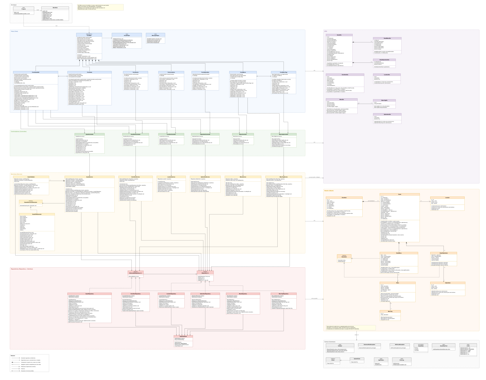
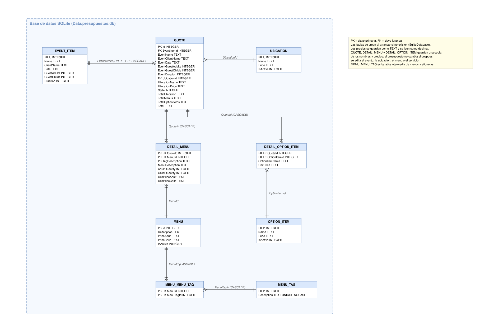

# Diagrama de clases — Presupuesto de Eventos

El diagrama está en **[UML.drawio](UML.drawio)**. Se abre con [draw.io](https://www.drawio.com/) (la app de escritorio o la web) y tiene dos páginas:

- **Clases:** todas las clases del proyecto, ordenadas por capa de arriba hacia abajo.
- **Base de datos:** las tablas de SQLite con sus claves.

Para verlo sin abrir draw.io están las imágenes [UML_Clases.svg](UML_Clases.svg) y [UML_BaseDeDatos.svg](UML_BaseDeDatos.svg). Si se modifica el `.drawio`, hay que volver a exportarlas desde draw.io (Archivo → Exportar como → SVG).

Las reglas de negocio, el recorrido de los datos y los conceptos de POO aplicados están en el [README](../README.md).

---

## Cómo está ordenado

Las capas van **de arriba hacia abajo**, en el mismo orden en que viaja un pedido:

| Franja | Qué tiene |
|---|---|
| **Arranque** | `Program`, que abre `FormMain`, y `MockData`, que carga los datos de prueba si la base está vacía |
| **Vista (View)** | `FormMain` arriba y, debajo, un formulario por pestaña. Al costado, `FormReport`, `QuotePdf` y `FormQuoteEdit`. Arriba a la derecha, `VisualHelper` y `MessageHelper` |
| **Controladores (Controller)** | Un controller por módulo |
| **Servicios (Service)** | Un service por módulo, y `QuoteValidator` al costado de `QuoteService` |
| **Repositorios (Repository + Interface)** | `IRepository<T>` arriba, los seis repositorios en el medio y `SqliteDatabase` abajo |

Cada módulo ocupa **una columna**: el formulario, su controller, su service y su repositorio quedan uno debajo del otro. De izquierda a derecha: Presupuestos (`Quote`), Eventos, Ubicaciones, Servicios adicionales (`OptionItem`), Menús y Etiquetas (`MenuTag`).

A la derecha, en columnas aparte porque las usan varias capas:

- **DTO**, a la altura de la Vista, los Controllers y los Services, que son las capas por donde viajan.
- **Modelo (Model)**, a la altura de los Services y los Repositorios, que son las capas que lo usan.
- **Común (Common)**, debajo del Modelo.

Las flechas gruesas punteadas entre franjas resumen dependencias que tienen casi todas las clases de una capa (por ejemplo, "los Services convierten DTO y Model"). Así no hace falta dibujar una flecha por cada clase.

## Notación

| Flecha | Relación | Dónde aparece |
|---|---|---|
| Línea con flecha abierta | **Asociación**: guarda una referencia como atributo | Form → Controller, Service → `IRepository<T>`, Repository → `SqliteDatabase`, `Quote` → `Ubication`, línea → `Menu` / `OptionItem` |
| Punteada con flecha abierta | **Dependencia**: la usa o la crea dentro de un método | Controller → Service, `Program` → `FormMain` |
| Rombo lleno | **Composición**: la parte vive y muere con el todo | `FormMain` → formularios, `Quote` → sus líneas, `EventItem` → `Quote`, `QuoteDto` → sus líneas |
| Rombo vacío | **Agregación**: partes compartidas que existen solas | `Menu` → `MenuTag`, `MenuDto` → `MenuTagDto` |
| Punteada con triángulo vacío | **Realización**: implementa una interfaz | Los seis repositorios → `IRepository<T>`, `DetailMenu` y `DetailOptionItem` → `IQuoteItem` |
| Línea con triángulo vacío | **Herencia** | `NotFoundException` → `BusinessRuleException` |
| Flecha en las dos puntas | Asociación en los dos sentidos | `FormIndex` ↔ `FormReport`, `FormMenus` ↔ `FormMenuTags` |

Miembros: `-` privado, `+` público, subrayado = estático, `/` = propiedad calculada.

---

## Decisiones que muestra el diagrama

**Vista**
- `FormMain` crea los siete formularios y los seis Controllers, y le pasa a cada formulario los Controllers que necesita. Las flechas hacia los Controllers salen de cada formulario, que los guarda como atributo.
- `FormIndex` (la lista), `FormQuoteEdit` (la carga) y `FormReport` (la vista previa) comparten el panel de la pestaña Inicio: se crean con `TopLevel = false` y `Dock = Fill`, y se alternan mostrando uno y escondiendo los otros. `FormIndex` se conoce con los otros dos, igual que `FormMenus` y `FormMenuTags` en Catering.
- `QuoteService` ◆— `QuoteValidator` es **composición**: el service crea su validador en el constructor y le delega las reglas de los presupuestos.

**Controller → Service**
- Es **dependencia**: cada método del Controller hace `new XService()` y lo descarta. Los Controllers no guardan estado.

**Sin Service → Service**
- Los services no se crean entre sí. Cada uno recibe por constructor los repositorios que necesita: `QuoteService` los de eventos, ubicaciones, menús y servicios; `EventItemService` el de presupuestos; `MenuService` el de etiquetas y `MenuTagService` el de menús. Así no hay acoplamiento entre services ni ciclos.

**Service → `IRepository<T>`**
- Es **asociación con la interfaz**: cada Service recibe por constructor los `IRepository<T>` que necesita (inyección de dependencias). El constructor sin parámetros, que usa el Controller, le pasa los repositorios reales con `XRepository.getInstance()`. El Service no sabe que los datos están en SQLite.

**Repositorios**
- Son **singleton**: constructor privado, atributo estático `instance` y `getInstance()`.
- Cada uno guarda la referencia a `SqliteDatabase`, que también es singleton.
- `removeById` existe en todos porque lo pide la interfaz, aunque Ubicación, Menú y Servicio usan baja lógica.

**Modelo**
- Cada atributo tiene su propiedad pública de **solo lectura** (get público, set privado que valida). Para no duplicar cada línea, el diagrama muestra solo los atributos.
- Las clases que se leen de la base tienen un **constructor de lectura**, que recibe los datos guardados.
- **Polimorfismo en el dominio:** `DetailMenu` y `DetailOptionItem` implementan `IQuoteItem` (`Description` y `Subtotal`). `Quote.getItems()` devuelve todos los ítems como `List<IQuoteItem>` y `calculateTotals()` suma sus subtotales sin saber de qué tipo es cada uno. Para agregar un ítem nuevo alcanza con otra clase que implemente la interfaz.
- `EventItem` → `Quote` es **composición conceptual**: en el código `Quote` guarda `EventItemId` (no una referencia), y borrar el evento borra sus presupuestos (`EventItemService.removeEventItem` y `ON DELETE CASCADE`).
- `Quote`, `DetailMenu` y `DetailOptionItem` mantienen la **asociación** con la ubicación, el menú y el servicio reales, pero además guardan una **copia** de nombres y precios. Por eso un presupuesto no cambia si después se edita el catálogo.
- `DetailMenu` guarda el **texto** de la etiqueta (`_tagDescription`), no un `MenuTag`: no hay flecha hacia `MenuTag`.

**Común**
- `Validator`, `BusinessRuleException`, `NotFoundException` y el enum `EstadoPresupuesto`. El Model valida con `Validator` y lanza `BusinessRuleException`; la Vista la atrapa y la muestra con `MessageHelper`.

---

## Base de datos

Decisiones del esquema:

- **Importes:** los `decimal` se guardan como `TEXT`, para no perder precisión. Es lo que hace `Microsoft.Data.Sqlite` por defecto.
- **Enums:** `EstadoPresupuesto` se guarda como su número (`INTEGER`).
- **Booleanos:** `IsActive` es `0/1`.
- **Fechas:** `EVENT_ITEM.Date` y `QUOTE.EventDate` se guardan como `TEXT` en formato ISO (`yyyy-MM-dd HH:mm:ss`).
- **Etiquetas:** la relación muchos a muchos entre menús y etiquetas se resuelve con la tabla intermedia `MENU_MENU_TAG`. Sus dos claves foráneas llevan `ON DELETE CASCADE`: borrar una etiqueta la quita de todos los menús. `MENU_TAG.Description` es `UNIQUE COLLATE NOCASE`, para que no haya dos etiquetas con el mismo nombre.
- **Borrado en cascada:** las claves foráneas hacia `EVENT_ITEM` y `QUOTE` llevan `ON DELETE CASCADE`. Borrar un evento borra sus presupuestos y sus líneas. `SqliteDatabase` activa las claves foráneas al armar la conexión (`ForeignKeys = true`).
- **Baja lógica:** `UBICATION`, `MENU` y `OPTION_ITEM` nunca se borran físicamente, así que las claves foráneas desde los presupuestos nunca quedan colgadas.
- **Datos congelados:** `QUOTE` guarda una copia de los datos del evento y de la ubicación, y `DETAIL_MENU` y `DETAIL_OPTION_ITEM` guardan el nombre y el precio de cada línea. También se guardan los totales.
- **Etiqueta de cada línea:** `DETAIL_MENU.TagDescription` es texto y forma parte de la clave: el mismo menú puede estar varias veces en un presupuesto, una por etiqueta.
