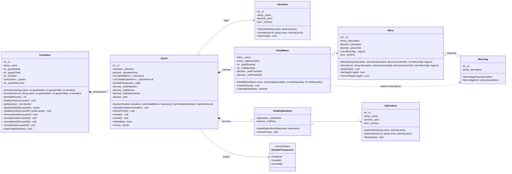
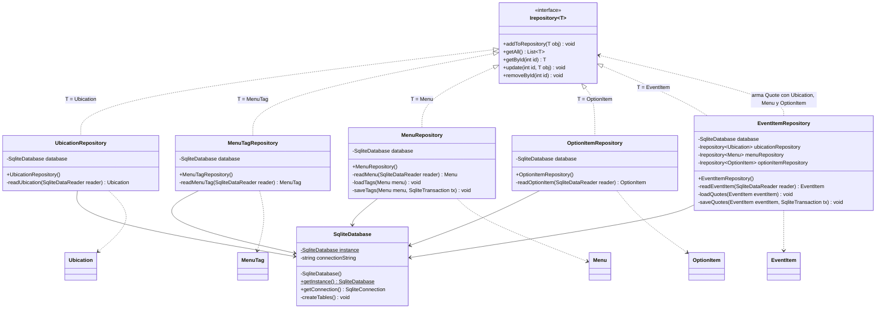
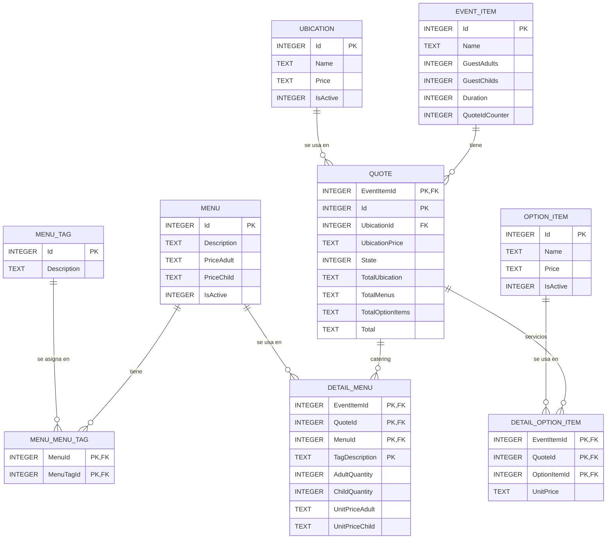
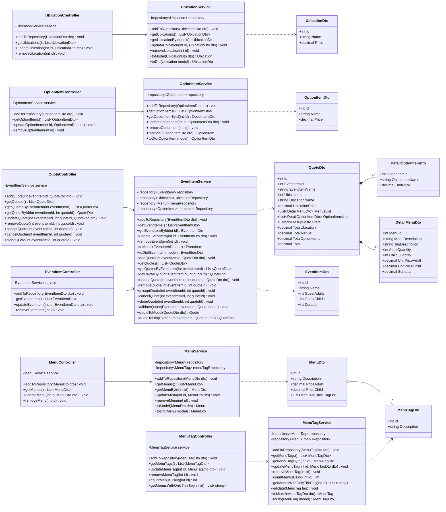
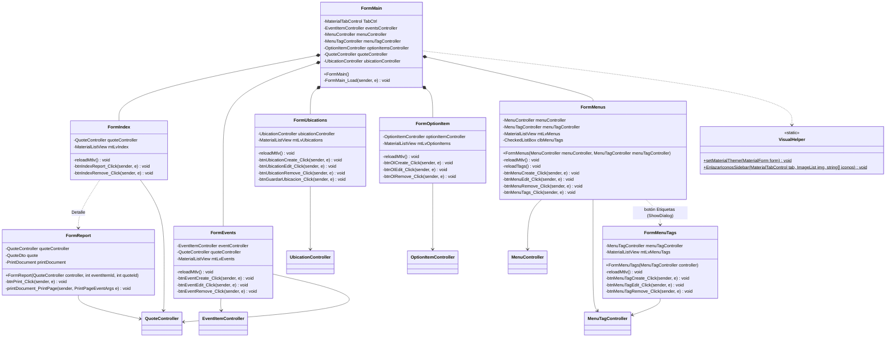

# Diagrama de clases — Presupuesto de Eventos

El diagrama está dividido en partes para que se pueda leer, y la sección 5 las junta en un diagrama completo con todas las capas conectadas. El orden en que se implementa está en [PlanDeImplementacion.md](PlanDeImplementacion.md). Las reglas de cada método
están en [ReglasDeNegocio.md](ReglasDeNegocio.md). Para verlo renderizado, abrí [UML.html](UML.html)
en el navegador.

> **Pasarlo a draw.io:** Organizar → Insertar → Avanzado → Mermaid, y pegar el bloque de código de cada diagrama.

**Cambios respecto del UML anterior**
- Se agrega la interfaz `Irepository<T>`, que implementan los 5 repositorios. Los métodos de los repositorios pasan a ser los de la interfaz: `getAll`, `getById`, `update`, `removeById`.
- `EventItem` es el **contenedor** de sus presupuestos (composición): tiene `List<Quote>` y asigna los ids de cada presupuesto. Por eso **no existen `QuoteRepository` ni `QuoteService`**: los presupuestos se guardan dentro de su evento, en `EventItemRepository`, y se manejan desde `EventItemService`. `QuoteController` se mantiene como fachada para las pantallas.
- `DetailMenus` pasa a llamarse `DetailMenu`. Separa cantidad de adultos y de niños, porque `Menu` tiene precio por adulto y por niño.
- `Quote` agrega `_state`, `_totalUbication`, `_total` y los métodos `calculateTotals`, `accept`, `cancel`, `clone` e `isEditable`.
- **Precios congelados:** `Quote`, `DetailMenu` y la nueva clase `DetailOptionItem` guardan una copia de los precios. Al aceptar un presupuesto, el detalle línea por línea y los totales quedan fijos.
- `MenuTag` pasa a ser una entidad con su propio CRUD (`MenuTagRepository`, `MenuTagService`, `MenuTagController`, `FormMenuTags`). Las etiquetas se crean desde un botón **Etiquetas** en la pestaña Catering, y al crear o editar un menú se eligen de una lista con casillas.
- Las etiquetas funcionan como **variantes del plato**: cada `DetailMenu` agrega `_tagDescription`, así un presupuesto puede pedir, por ejemplo, 10 milanesas estándar y 5 veganas. Todo menú tiene al menos una etiqueta.
- `Ubication`, `Menu` y `OptionItem` agregan `_isActive` y `deactivate()`, para la baja lógica.
- Los DTO referencian otras entidades por **id** (`UbicationId`, `MenuId`), no por objeto del Model.
- `FormIndex` usa `QuoteController`: lista presupuestos, no eventos.
- **Persistencia en SQLite:** los repositorios guardan en la base a través de `SqliteDatabase`, que es el único singleton, en lugar de listas en memoria. Se agrega el esquema de la base (2b).
- **Impresión:** se eliminan `ReportService` y `ReportController`. `FormReport` obtiene el `QuoteDto` de `QuoteController.getQuoteById` e imprime con `PrintDocument` y `PrintPreviewDialog`. Para PDF se usa la impresora "Microsoft Print to PDF".

---

## 1. Modelo de dominio (Model)

**Precios congelados:**
- Cada presupuesto guarda **su propia copia** de los precios: `_ubicationPrice` en `Quote`, `_unitPriceAdult` y `_unitPriceChild` en `DetailMenu`, `_unitPrice` en `DetailOptionItem`.
- Mientras el presupuesto está Pendiente, `calculateTotals(duration)` llama a `refreshPrices()`, que copia los precios actuales, y después calcula.
- Si está Aceptado o Cancelado, `calculateTotals` no hace nada. Así, el detalle y el total siempre coinciden con lo que se acordó.

**Etiquetas como variantes del plato:**
- Un `Menu` tiene una o más etiquetas: las variantes que ofrece (por ejemplo, la Milanesa se ofrece estándar, vegana y sin TACC).
- Cada `DetailMenu` es **una variante**: menú + etiqueta + cantidad de adultos y de niños. Para pedir 10 milanesas estándar y 5 veganas se cargan dos líneas.
- La etiqueta no cambia el precio: todas las variantes usan el precio por adulto y por niño del menú.
- `DetailMenu` guarda el **texto** de la etiqueta (`_tagDescription`), no el objeto `MenuTag`. Por eso la relación es punteada: copia la descripción al armar la línea y después no depende de la etiqueta.

---

## 2. Persistencia (Interface + Repository + SQLite)

Los datos se guardan en una base **SQLite**: un único archivo, `presupuestos.db`, junto al ejecutable. Se accede con el paquete NuGet `Microsoft.Data.Sqlite`, con SQL escrito a mano.

- Cada repositorio implementa `Irepository<T>`. Los Services lo usan **solo a través de la interfaz**.
- `SqliteDatabase` es el **único singleton**: hay una sola base, y su `getInstance()` crea las tablas la primera vez. Los repositorios no necesitan ser singleton, porque los datos viven en la base y no en el objeto. Cada Service crea los suyos con `new`.

### 2a. Clases de persistencia

- **Presupuestos:** no tienen repositorio propio. `EventItemRepository` guarda y lee cada evento **junto con sus presupuestos**. Al leer un evento, carga sus presupuestos (`loadQuotes`) y arma cada `Quote` con la `Ubication`, los `Menu` y los `OptionItem` que obtiene de los otros repositorios. Al guardarlo (`addToRepository` o `update`), borra y vuelve a insertar sus presupuestos dentro de una transacción (`saveQuotes`).
- **Ids:** los asigna la base (`AUTOINCREMENT`). El repositorio los copia al objeto después del `INSERT`. Los ids de los presupuestos los sigue asignando su evento (`QuoteIdCounter`).
- **Baja lógica:** `removeById` en Ubication, Menu y OptionItem no se usa, porque el Service hace la baja lógica con `update`. Se implementa igual porque lo exige la interfaz.
- **Etiquetas de un menú:** `MenuRepository` las lee (`loadTags`) y las guarda (`saveTags`) en la tabla intermedia `MENU_MENU_TAG`. `MenuTagRepository.removeById` sí borra físicamente, y la base quita la etiqueta de todos los menús por `ON DELETE CASCADE`.

### 2b. Esquema de la base de datos

Decisiones del esquema:
- **Importes:** los `decimal` se guardan como `TEXT`, para no perder precisión. Es lo que hace `Microsoft.Data.Sqlite` por defecto.
- **Enums:** `EstadoPresupuesto` se guarda como su número (`INTEGER`).
- **Etiquetas:** la relación muchos a muchos entre menús y etiquetas se resuelve con la tabla intermedia `MENU_MENU_TAG`. Sus dos claves foráneas llevan `ON DELETE CASCADE`: borrar una etiqueta la quita de todos los menús. `MENU_TAG.Description` es `UNIQUE COLLATE NOCASE`, para que no haya dos etiquetas con el mismo nombre (V13).
- **Booleanos:** `IsActive` es `0/1`.
- **Clave del presupuesto:** `QUOTE` tiene clave compuesta (`EventItemId`, `Id`), porque el id del presupuesto lo asigna su evento.
- **Borrado en cascada:** las claves foráneas que salen de `EVENT_ITEM` y `QUOTE` llevan `ON DELETE CASCADE`. Así, borrar un evento borra sus presupuestos y sus detalles (regla I2). Hay que activar `PRAGMA foreign_keys = ON` al abrir la conexión.
- **Baja lógica:** como `UBICATION`, `MENU` y `OPTION_ITEM` nunca se borran físicamente, las claves foráneas desde los presupuestos nunca quedan colgadas.
- **Precios congelados:** `QUOTE.UbicationPrice`, `DETAIL_MENU.UnitPriceAdult` y `UnitPriceChild`, y `DETAIL_OPTION_ITEM.UnitPrice` guardan el precio de cada línea al momento del presupuesto (regla E3).
- **Etiqueta de cada línea:** `DETAIL_MENU.TagDescription` guarda el **texto** de la etiqueta, no su id. Así se puede borrar o renombrar una etiqueta sin tocar los presupuestos. Forma parte de la clave: el mismo menú puede estar varias veces en un presupuesto, una por etiqueta (V7).
- **Totales:** también se guardan, porque `TotalUbication` depende de la duración del evento. Si después se cambia la duración, un presupuesto Aceptado tiene que conservar su total.

---

## 3. Lógica (Service + Controller + Dto)

Cada módulo sigue el mismo patrón que Ubicaciones: **View → Controller → Service → Repository**.
El Controller **no tiene lógica**: guarda un `Service` como atributo y le delega cada llamada.
El Service convierte entre DTO y Model (`toModel` y `toDto`) y aplica las reglas que involucran varias entidades.

Cada Service crea sus repositorios en el constructor (por ejemplo, `Irepository<Ubication> repository = new UbicationRepository()`) y los usa **solo a través de `Irepository<T>`**.
En `MenuTagService`:
- `getMenusWithOnlyThisTag(id)` devuelve los nombres de los menús cuya **única** etiqueta es esa. Si la lista no está vacía, la etiqueta no se puede borrar, porque esos menús quedarían sin etiquetas (V14). La View muestra el mensaje ("No se puede eliminar: es la única etiqueta de Milanesa, Ravioles").
- `removeMenuTag(id)` primero revisa `getMenusWithOnlyThisTag(id)` y, si hay alguno, lanza `InvalidOperationException`. Si no, borra la etiqueta **físicamente** y la quita de todos los menús que la tengan: para cada menú con `hasTag(id)`, llama a `removeTag(id)` y lo guarda con `update`. Así funciona igual con listas en memoria y con SQLite, donde además la cascada lo garantiza.
- `countMenusUsing(id)` le sirve a la View para el mensaje de confirmación ("Esta etiqueta está asignada a 3 menús. ¿Eliminarla igualmente?").
- Borrar una etiqueta **no afecta a los presupuestos**: cada línea de catering guarda una copia del texto de la etiqueta (`_tagDescription`), igual que guarda los precios.
- En `MenuService.toModel`, los ids de `MenuDto.TagList` se convierten en objetos `MenuTag` buscándolos en `menuTagRepository`.

En `UbicationService`, `MenuService` y `OptionItemService`:
- `removeX(id)` hace la **baja lógica**: busca el modelo, llama a `deactivate()` y lo guarda con `update`. No usa `removeById`.
- `getX()` devuelve **solo los activos**.
`EventItemService.quoteToModel` busca la `Ubication`, los `Menu` y los `OptionItem` por id en sus repositorios. Las operaciones sobre presupuestos siguen siempre el mismo camino:
1. Buscar el `EventItem` en `EventItemRepository`.
2. Llamar al método del evento (`addQuote`, `acceptQuote`, …).
3. Guardar el evento con `update`.

---

## 4. Vistas (View)

---

## 5. Diagrama completo (todas las capas)

```mermaid
classDiagram
direction LR

namespace View {
  class FormMain {
    -MaterialTabControl TabCtrl
    -EventItemController eventsController
    -MenuController menuController
    -MenuTagController menuTagController
    -OptionItemController optionItemsController
    -QuoteController quoteController
    -UbicationController ubicationController
    +FormMain()
    -FormMain_Load(sender, e) void
  }
  class FormIndex {
    -QuoteController quoteController
    -MaterialListView mtLvIndex
    -reloadMtlv() void
    -btnIndexReport_Click(sender, e) void
    -btnIndexRemove_Click(sender, e) void
  }
  class FormEvents {
    -EventItemController eventController
    -QuoteController quoteController
    -MaterialListView mtLvEvents
    -reloadMtlv() void
    -btnEventCreate_Click(sender, e) void
    -btnEventEdit_Click(sender, e) void
    -btnEventRemove_Click(sender, e) void
  }
  class FormUbications {
    -UbicationController ubicationController
    -MaterialListView mtLvUbications
    -reloadMtlv() void
    -btnUbicationCreate_Click(sender, e) void
    -btnUbicationEdit_Click(sender, e) void
    -btnUbicationRemove_Click(sender, e) void
    -btnGuardarUbicacion_Click(sender, e) void
  }
  class FormOptionItem {
    -OptionItemController optionItemController
    -MaterialListView mtLvOptionItems
    -reloadMtlv() void
    -btnOICreate_Click(sender, e) void
    -btnOIEdit_Click(sender, e) void
    -btnOIRemove_Click(sender, e) void
  }
  class FormMenus {
    -MenuController menuController
    -MenuTagController menuTagController
    -MaterialListView mtLvMenus
    -CheckedListBox clbMenuTags
    +FormMenus(MenuController menuController, MenuTagController menuTagController)
    -reloadMtlv() void
    -reloadTags() void
    -btnMenuCreate_Click(sender, e) void
    -btnMenuEdit_Click(sender, e) void
    -btnMenuRemove_Click(sender, e) void
    -btnMenuTags_Click(sender, e) void
  }
  class FormMenuTags {
    -MenuTagController menuTagController
    -MaterialListView mtLvMenuTags
    +FormMenuTags(MenuTagController controller)
    -reloadMtlv() void
    -btnMenuTagCreate_Click(sender, e) void
    -btnMenuTagEdit_Click(sender, e) void
    -btnMenuTagRemove_Click(sender, e) void
  }
  class FormReport {
    -QuoteController quoteController
    -QuoteDto quote
    -PrintDocument printDocument
    +FormReport(QuoteController controller, int eventItemId, int quoteId)
    -btnPrint_Click(sender, e) void
    -printDocument_PrintPage(sender, PrintPageEventArgs e) void
  }
  class VisualHelper {
    <<static>>
    +setMaterialTheme(MaterialForm form)$ void
    +EnlazarIconosSidebar(MaterialTabControl tab, ImageList img, string[] iconos)$ void
  }
}

namespace Controller {
  class UbicationController {
    -UbicationService service
    +addToRepository(UbicationDto dto) void
    +getUbications() List~UbicationDto~
    +updateUbication(int id, UbicationDto dto) void
    +removeUbication(int id) void
  }
  class MenuController {
    -MenuService service
    +addToRepository(MenuDto dto) void
    +getMenus() List~MenuDto~
    +updateMenu(int id, MenuDto dto) void
    +removeMenu(int id) void
  }
  class MenuTagController {
    -MenuTagService service
    +addToRepository(MenuTagDto dto) void
    +getMenuTags() List~MenuTagDto~
    +updateMenuTag(int id, MenuTagDto dto) void
    +removeMenuTag(int id) void
    +countMenusUsing(int id) int
    +getMenusWithOnlyThisTag(int id) List~string~
  }
  class OptionItemController {
    -OptionItemService service
    +addToRepository(OptionItemDto dto) void
    +getOptionItems() List~OptionItemDto~
    +updateOptionItem(int id, OptionItemDto dto) void
    +removeOptionItem(int id) void
  }
  class EventItemController {
    -EventItemService service
    +addToRepository(EventItemDto dto) void
    +getEventItems() List~EventItemDto~
    +updateEventItem(int id, EventItemDto dto) void
    +removeEventItem(int id) void
  }
  class QuoteController {
    -EventItemService service
    +addQuote(int eventItemId, QuoteDto dto) void
    +getQuotes() List~QuoteDto~
    +getQuotesByEventItem(int eventItemId) List~QuoteDto~
    +getQuoteById(int eventItemId, int quoteId) QuoteDto
    +updateQuote(int eventItemId, int quoteId, QuoteDto dto) void
    +removeQuote(int eventItemId, int quoteId) void
    +acceptQuote(int eventItemId, int quoteId) void
    +cancelQuote(int eventItemId, int quoteId) void
    +cloneQuote(int eventItemId, int quoteId) void
  }
}

namespace Service {
  class UbicationService {
    -Irepository~Ubication~ repository
    +addToRepository(UbicationDto dto) void
    +getUbications() List~UbicationDto~
    +getUbicationById(int id) UbicationDto
    +updateUbication(int id, UbicationDto dto) void
    +removeUbication(int id) void
    +toModel(UbicationDto dto) Ubication
    +toDto(Ubication model) UbicationDto
  }
  class MenuTagService {
    -Irepository~MenuTag~ repository
    -Irepository~Menu~ menuRepository
    +addToRepository(MenuTagDto dto) void
    +getMenuTags() List~MenuTagDto~
    +getMenuTagById(int id) MenuTagDto
    +updateMenuTag(int id, MenuTagDto dto) void
    +removeMenuTag(int id) void
    +countMenusUsing(int id) int
    +getMenusWithOnlyThisTag(int id) List~string~
    -validate(MenuTag tag) void
    +toModel(MenuTagDto dto) MenuTag
    +toDto(MenuTag model) MenuTagDto
  }
  class MenuService {
    -Irepository~Menu~ repository
    -Irepository~MenuTag~ menuTagRepository
    +addToRepository(MenuDto dto) void
    +getMenus() List~MenuDto~
    +getMenuById(int id) MenuDto
    +updateMenu(int id, MenuDto dto) void
    +removeMenu(int id) void
    +toModel(MenuDto dto) Menu
    +toDto(Menu model) MenuDto
  }
  class OptionItemService {
    -Irepository~OptionItem~ repository
    +addToRepository(OptionItemDto dto) void
    +getOptionItems() List~OptionItemDto~
    +getOptionItemById(int id) OptionItemDto
    +updateOptionItem(int id, OptionItemDto dto) void
    +removeOptionItem(int id) void
    +toModel(OptionItemDto dto) OptionItem
    +toDto(OptionItem model) OptionItemDto
  }
  class EventItemService {
    -Irepository~EventItem~ repository
    -Irepository~Ubication~ ubicationRepository
    -Irepository~Menu~ menuRepository
    -Irepository~OptionItem~ optionItemRepository
    +addToRepository(EventItemDto dto) void
    +getEventItems() List~EventItemDto~
    +getEventItemById(int id) EventItemDto
    +updateEventItem(int id, EventItemDto dto) void
    +removeEventItem(int id) void
    +toModel(EventItemDto dto) EventItem
    +toDto(EventItem model) EventItemDto
    +addQuote(int eventItemId, QuoteDto dto) void
    +getQuotes() List~QuoteDto~
    +getQuotesByEventItem(int eventItemId) List~QuoteDto~
    +getQuoteById(int eventItemId, int quoteId) QuoteDto
    +updateQuote(int eventItemId, int quoteId, QuoteDto dto) void
    +removeQuote(int eventItemId, int quoteId) void
    +acceptQuote(int eventItemId, int quoteId) void
    +cancelQuote(int eventItemId, int quoteId) void
    +cloneQuote(int eventItemId, int quoteId) void
    -validateQuote(EventItem eventItem, Quote quote) void
    +quoteToModel(QuoteDto dto) Quote
    +quoteToDto(EventItem eventItem, Quote quote) QuoteDto
  }
}

namespace Dto {
  class UbicationDto {
    +int Id
    +string Name
    +decimal Price
  }
  class OptionItemDto {
    +int Id
    +string Name
    +decimal Price
  }
  class MenuDto {
    +int Id
    +string Description
    +decimal PriceAdult
    +decimal PriceChild
    +List~MenuTagDto~ TagList
  }
  class MenuTagDto {
    +int Id
    +string Description
  }
  class EventItemDto {
    +int Id
    +string Name
    +int GuestAdults
    +int GuestChilds
    +int Duration
  }
  class DetailMenuDto {
    +int MenuId
    +string MenuDescription
    +string TagDescription
    +int AdultQuantity
    +int ChildQuantity
    +decimal UnitPriceAdult
    +decimal UnitPriceChild
    +decimal Subtotal
  }
  class DetailOptionItemDto {
    +int OptionItemId
    +string OptionItemName
    +decimal UnitPrice
  }
  class QuoteDto {
    +int Id
    +int EventItemId
    +string EventItemName
    +int UbicationId
    +string UbicationName
    +decimal UbicationPrice
    +List~DetailMenuDto~ MenusList
    +List~DetailOptionItemDto~ OptionItemsList
    +EstadoPresupuesto State
    +decimal TotalUbication
    +decimal TotalMenus
    +decimal TotalOptionItems
    +decimal Total
  }
}

namespace Model {
  class EventItem {
    -int _id
    -string _name
    -int _guestAdults
    -int _guestChilds
    -int _duration
    -List~Quote~ _quotes
    -int _quoteIdCounter
    +EventItem(string name, int guestAdults, int guestChilds, int duration)
    +EventItem(int id, string name, int guestAdults, int guestChilds, int duration)
    +getTotalGuests() int
    +addQuote(Quote quote) void
    +getQuotes() List~Quote~
    +getQuoteById(int quoteId) Quote
    +updateQuote(int quoteId, Quote quote) void
    +removeQuote(int quoteId) void
    +acceptQuote(int quoteId) void
    +cancelQuote(int quoteId) void
    +cloneQuote(int quoteId) void
    +hasAcceptedQuote() bool
  }
  class Quote {
    -int _id
    -Ubication _ubication
    -decimal _ubicationPrice
    -List~DetailMenu~ _menusList
    -List~DetailOptionItem~ _optionItemList
    -EstadoPresupuesto _state
    -decimal _totalUbication
    -decimal _totalMenus
    -decimal _totalOptionItems
    -decimal _total
    +Quote(Ubication ubication, List~DetailMenu~ menusList, List~DetailOptionItem~ optionItemList)
    +calculateTotals(int duration) void
    -refreshPrices() void
    +accept() void
    +cancel() void
    +isEditable() bool
    +clone() Quote
  }
  class DetailMenu {
    -Menu _menu
    -string _tagDescription
    -int _adultQuantity
    -int _childQuantity
    -decimal _unitPriceAdult
    -decimal _unitPriceChild
    +DetailMenu(Menu menu, string tagDescription, int adultQuantity, int childQuantity)
    +refreshPrices() void
    +calculateSubtotal() decimal
  }
  class DetailOptionItem {
    -OptionItem _optionItem
    -decimal _unitPrice
    +DetailOptionItem(OptionItem optionItem)
    +refreshPrice() void
  }
  class Menu {
    -int? _id
    -string _description
    -decimal _priceAdult
    -decimal _priceChild
    -List~MenuTag~ _tagList
    -bool _isActive
    +Menu(string description, decimal priceAdult, decimal priceChild, List~MenuTag~ tagList)
    +Menu(int id, string description, decimal priceAdult, decimal priceChild, List~MenuTag~ tagList)
    +deactivate() void
    +hasTag(int tagId) bool
    +removeTag(int tagId) void
  }
  class Ubication {
    -int _id
    -string _name
    -decimal _price
    -bool _isActive
    +Ubication(string name, decimal price)
    +Ubication(int id, string name, decimal price)
    +deactivate() void
  }
  class OptionItem {
    -int _id
    -string _name
    -decimal _price
    -bool _isActive
    +OptionItem(string name, decimal price)
    +OptionItem(int id, string name, decimal price)
    +deactivate() void
  }
  class MenuTag {
    -int _id
    -string _description
    +MenuTag(string description)
    +MenuTag(int id, string description)
  }
  class EstadoPresupuesto {
    <<enumeration>>
    Pendiente
    Aceptado
    Cancelado
  }
}

namespace Persistencia {
  class Irepository~T~ {
    <<interface>>
    +addToRepository(T obj) void
    +getAll() List~T~
    +getById(int id) T
    +update(int id, T obj) void
    +removeById(int id) void
  }
  class SqliteDatabase {
    -SqliteDatabase instance$
    -string connectionString
    -SqliteDatabase()
    +getInstance()$ SqliteDatabase
    +getConnection() SqliteConnection
    -createTables() void
  }
  class UbicationRepository {
    -SqliteDatabase database
    +UbicationRepository()
    -readUbication(SqliteDataReader reader) Ubication
  }
  class MenuTagRepository {
    -SqliteDatabase database
    +MenuTagRepository()
    -readMenuTag(SqliteDataReader reader) MenuTag
  }
  class MenuRepository {
    -SqliteDatabase database
    +MenuRepository()
    -readMenu(SqliteDataReader reader) Menu
    -loadTags(Menu menu) void
    -saveTags(Menu menu, SqliteTransaction tx) void
  }
  class OptionItemRepository {
    -SqliteDatabase database
    +OptionItemRepository()
    -readOptionItem(SqliteDataReader reader) OptionItem
  }
  class EventItemRepository {
    -SqliteDatabase database
    -Irepository~Ubication~ ubicationRepository
    -Irepository~Menu~ menuRepository
    -Irepository~OptionItem~ optionItemRepository
    +EventItemRepository()
    -readEventItem(SqliteDataReader reader) EventItem
    -loadQuotes(EventItem eventItem) void
    -saveQuotes(EventItem eventItem, SqliteTransaction tx) void
  }
}

%% ---------- View → Controller ----------
FormMain *-- FormIndex
FormMain *-- FormEvents
FormMain *-- FormUbications
FormMain *-- FormOptionItem
FormMain *-- FormMenus
FormMain ..> VisualHelper
FormIndex ..> FormReport : Detalle

FormIndex --> QuoteController
FormEvents --> EventItemController
FormEvents --> QuoteController
FormUbications --> UbicationController
FormOptionItem --> OptionItemController
FormMenus --> MenuController
FormMenus --> MenuTagController
FormMenus ..> FormMenuTags : botón Etiquetas (ShowDialog)
FormMenuTags --> MenuTagController
FormReport --> QuoteController

%% ---------- Controller → Service ----------
UbicationController --> UbicationService
MenuController --> MenuService
MenuTagController --> MenuTagService
OptionItemController --> OptionItemService
EventItemController --> EventItemService
QuoteController --> EventItemService

%% ---------- Service → Repository ----------
UbicationService --> Irepository : Ubication
MenuTagService --> Irepository : MenuTag, Menu
MenuService --> Irepository : Menu, MenuTag
OptionItemService --> Irepository : OptionItem
EventItemService --> Irepository : EventItem, Ubication, Menu, OptionItem

%% ---------- Service → Dto y Model ----------
UbicationService ..> UbicationDto
MenuService ..> MenuDto
MenuTagService ..> MenuTagDto
OptionItemService ..> OptionItemDto
EventItemService ..> EventItemDto
EventItemService ..> QuoteDto
UbicationService ..> Ubication
MenuTagService ..> MenuTag
MenuService ..> Menu
OptionItemService ..> OptionItem
EventItemService ..> EventItem
FormReport --> QuoteDto
QuoteDto --> EstadoPresupuesto
MenuDto o-- "0..*" MenuTagDto
QuoteDto *-- "0..*" DetailMenuDto
QuoteDto *-- "0..*" DetailOptionItemDto

%% ---------- Model ----------
EventItem "1" *-- "0..*" Quote : presupuestos
Quote "0..*" --> "1" Ubication : lugar
Quote "1" *-- "0..*" DetailMenu : catering
Quote "1" *-- "0..*" DetailOptionItem : servicios
Quote --> EstadoPresupuesto : estado
DetailMenu "0..*" --> "1" Menu
DetailMenu ..> MenuTag : copia la descripcion
DetailOptionItem "0..*" --> "1" OptionItem
Menu "0..*" o-- "0..*" MenuTag : etiquetas

%% ---------- Persistencia ----------
Irepository <|.. UbicationRepository : T = Ubication
Irepository <|.. MenuTagRepository : T = MenuTag
Irepository <|.. MenuRepository : T = Menu
Irepository <|.. OptionItemRepository : T = OptionItem
Irepository <|.. EventItemRepository : T = EventItem

UbicationRepository --> SqliteDatabase
MenuTagRepository --> SqliteDatabase
MenuRepository --> SqliteDatabase
OptionItemRepository --> SqliteDatabase
EventItemRepository --> SqliteDatabase
EventItemRepository ..> Irepository : arma Quote con Ubication, Menu y OptionItem

UbicationRepository ..> Ubication
MenuTagRepository ..> MenuTag
MenuRepository ..> Menu
OptionItemRepository ..> OptionItem
EventItemRepository ..> EventItem
```

Las cuatro partes anteriores juntas en un solo diagrama, agrupadas por capa y conectadas entre sí. Se lee de izquierda a derecha siguiendo una llamada: **View → Controller → Service → `Irepository<T>` → SQLite**. El Service convierte entre **Dto** y **Model**, y el repositorio devuelve objetos del Model.

Cómo leerlo:
- **Flechas llenas (`-->`)**: una clase guarda a la otra como atributo (el Form guarda su Controller, el Controller su Service, el Service sus repositorios).
- **Flechas punteadas (`..>`)**: una clase usa a la otra sin guardarla (el Service crea Dtos y Models, el repositorio devuelve Models).
- **`Irepository<T>`** es el único punto de contacto entre Service y Persistencia. La etiqueta de cada flecha indica con qué `T` lo usa cada Service.
- **`QuoteController`** no tiene Service propio: apunta a `EventItemService`, porque los presupuestos viven dentro del evento.
