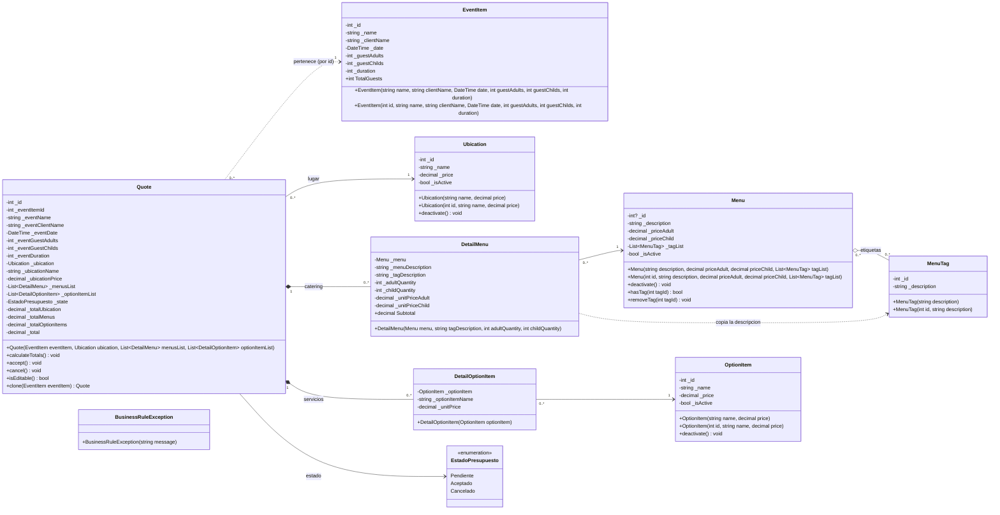
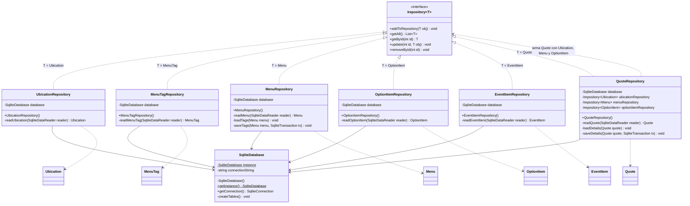
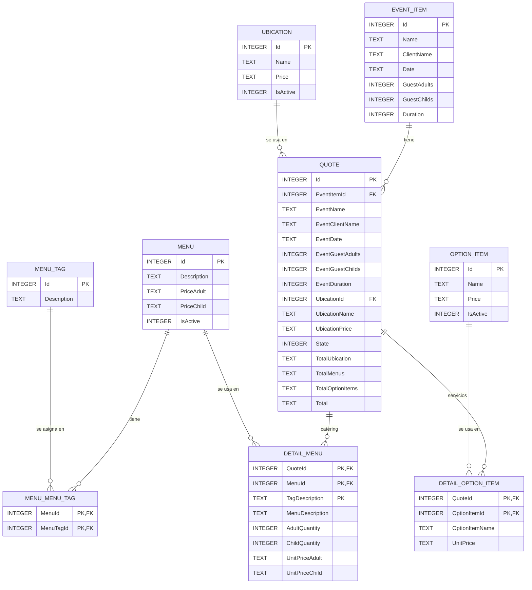
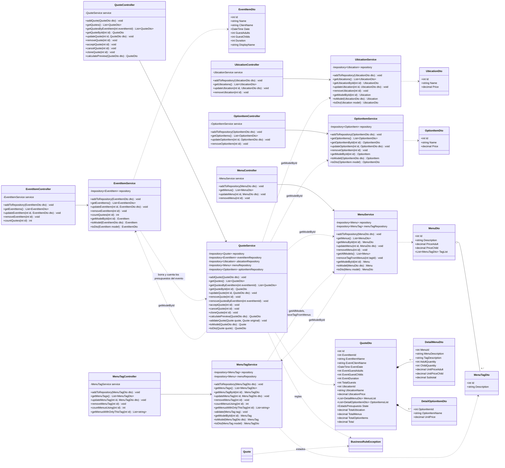

# Diagrama de clases — Presupuesto de Eventos

El diagrama está dividido en partes para que se pueda leer, y la sección 5 las junta en un diagrama completo con todas las capas conectadas. El orden en que se implementa está en [PlanDeImplementacion.md](PlanDeImplementacion.md). Las reglas de cada método
están en [ReglasDeNegocio.md](ReglasDeNegocio.md). Para verlo renderizado, abrí [UML.html](UML.html)
en el navegador.

> **Pasarlo a draw.io:** Organizar → Insertar → Avanzado → Mermaid, y pegar el bloque de código de cada diagrama.

**Cambios respecto del UML anterior**
- Se agrega la interfaz `Irepository<T>`, que implementan los 6 repositorios. Los métodos de los repositorios pasan a ser los de la interfaz: `getAll`, `getById`, `update`, `removeById`.
- Los presupuestos tienen **su propio módulo**: `Quote` guarda el id de su evento (`_eventItemId`), se guarda en `QuoteRepository` y toda su lógica vive en `QuoteService`. Al eliminar un evento, `EventItemService` le pide a `QuoteService` que borre sus presupuestos.
- Los presupuestos se arman desde la pestaña **Inicio** (`FormIndex`), que lista todos los presupuestos y tiene el panel de carga.
- `DetailMenus` pasa a llamarse `DetailMenu`. Separa cantidad de adultos y de niños, porque `Menu` tiene precio por adulto y por niño.
- `Quote` agrega `_state`, `_totalUbication`, `_total` y los métodos `calculateTotals`, `accept`, `cancel`, `clone` e `isEditable`.
- **Precios congelados:** `Quote`, `DetailMenu` y la nueva clase `DetailOptionItem` guardan una copia de los precios. Al aceptar un presupuesto, el detalle línea por línea y los totales quedan fijos.
- `MenuTag` pasa a ser una entidad con su propio CRUD (`MenuTagRepository`, `MenuTagService`, `MenuTagController`, `FormMenuTags`). Las etiquetas se crean desde un botón **Etiquetas** en la pestaña Catering, y al crear o editar un menú se eligen de una lista con casillas.
- Las etiquetas funcionan como **variantes del plato**: cada `DetailMenu` agrega `_tagDescription`, así un presupuesto puede pedir, por ejemplo, 10 milanesas estándar y 5 veganas. Todo menú tiene al menos una etiqueta.
- `EventItem` agrega `_clientName` (nombre del cliente) y `_date` (fecha y hora de inicio).
- `Ubication`, `Menu` y `OptionItem` agregan `_isActive` y `deactivate()`, para la baja lógica.
- Los DTO referencian otras entidades por **id** (`UbicationId`, `MenuId`), no por objeto del Model.
- `FormIndex` usa `QuoteController`: lista presupuestos, no eventos.
- **Persistencia en SQLite:** los repositorios guardan en la base a través de `SqliteDatabase`, que es el único singleton, en lugar de listas en memoria. Se agrega el esquema de la base (2b).
- **Carpeta `Common`:** tiene lo que usan todas las capas: `EstadoPresupuesto` y `BusinessRuleException`. El Model y el Service lanzan esa excepción, y la View la atrapa y la muestra con `MessageHelper`, por donde pasan todos los avisos.
- **Reglas fuera de la View:** los formularios solo convierten el texto a número y atrapan la excepción. Las reglas están en los `set` del Model y en el Service.
- **Un repositorio por service:** cada service usa solo su repositorio. Si necesita datos de otro, los pide a ese service con `getModelById`.
- **Vista previa y PDF:** se eliminan `ReportService` y `ReportController`. El botón **Detalle** de Inicio abre `FormReport`, en el mismo panel que `FormIndex`, que muestra la hoja del presupuesto. Su botón **Imprimir** la guarda como PDF, eligiendo el archivo con un diálogo "Guardar como", y se queda en la vista previa. La clase `QuotePdf` (View) dibuja la hoja con `PrintDocument`, la misma para la vista previa y el PDF, y la guarda con la impresora "Microsoft Print to PDF" de Windows. Se puede ver y guardar un presupuesto en cualquier estado, y la hoja muestra el estado.

---

## 1. Modelo de dominio (Model)



**Presupuestos y eventos:** un `Quote` no está guardado adentro de su evento. Guarda el **id** del evento (`_eventItemId`), igual que un DTO, y vive en su propio repositorio. Por eso la relación es punteada.

**Datos congelados:**
- Cada presupuesto guarda **su propia copia** de los datos: los del evento, `_ubicationName` y `_ubicationPrice` en `Quote`; `_menuDescription`, `_unitPriceAdult` y `_unitPriceChild` en `DetailMenu`; `_optionItemName` y `_unitPrice` en `DetailOptionItem`.
- Las copias se toman al crear o clonar el presupuesto, y se actualizan **solo cuando se edita y se guarda** un presupuesto Pendiente, porque `toModel` arma todo de nuevo.
- `calculateTotals()` usa los precios y la duración copiados. Si está Aceptado o Cancelado, no hace nada. Así, el detalle y el total siempre coinciden con lo que se acordó.

**Etiquetas como variantes del plato:**
- Un `Menu` tiene una o más etiquetas: las variantes que ofrece (por ejemplo, la Milanesa se ofrece estándar, vegana y sin TACC).
- Cada `DetailMenu` es **una variante**: menú + etiqueta + cantidad de adultos y de niños. Para pedir 10 milanesas estándar y 5 veganas se cargan dos líneas.
- La etiqueta no cambia el precio: todas las variantes usan el precio por adulto y por niño del menú.
- `DetailMenu` guarda el **texto** de la etiqueta (`_tagDescription`), no el objeto `MenuTag`. Por eso la relación es punteada: copia la descripción al armar la línea y después no depende de la etiqueta.

---

## 2. Persistencia (Interface + Repository + SQLite)

Los datos se guardan en una base **SQLite**: un único archivo, `presupuestos.db`, junto al ejecutable. Se accede con el paquete NuGet `Microsoft.Data.Sqlite`, con SQL escrito a mano.

- Cada repositorio implementa `Irepository<T>`. Los Services lo usan **solo a través de la interfaz**.
- `SqliteDatabase` es el **único singleton**: hay una sola base, y su `getInstance()` crea las tablas la primera vez. Los repositorios no necesitan ser singleton, porque los datos viven en la base y no en el objeto. Cada Service crea los suyos con `new`.

### 2a. Clases de persistencia



- **Presupuestos:** tienen su propio repositorio. `QuoteRepository` guarda cada presupuesto con sus líneas de catering y de servicios. Al leerlo, carga sus líneas (`loadDetails`) y arma el `Quote` con la `Ubication`, los `Menu` y los `OptionItem` que obtiene de los otros repositorios. Al guardarlo (`addToRepository` o `update`), borra y vuelve a insertar sus líneas dentro de una transacción (`saveDetails`).
- **Ids:** los asigna la base (`AUTOINCREMENT`). El repositorio los copia al objeto después del `INSERT`.
- **Baja lógica:** `removeById` en Ubication, Menu y OptionItem no se usa, porque el Service hace la baja lógica con `update`. Se implementa igual porque lo exige la interfaz.
- **Etiquetas de un menú:** `MenuRepository` las lee (`loadTags`) y las guarda (`saveTags`) en la tabla intermedia `MENU_MENU_TAG`. `MenuTagRepository.removeById` sí borra físicamente, y la base quita la etiqueta de todos los menús por `ON DELETE CASCADE`.

### 2b. Esquema de la base de datos



Decisiones del esquema:
- **Importes:** los `decimal` se guardan como `TEXT`, para no perder precisión. Es lo que hace `Microsoft.Data.Sqlite` por defecto.
- **Enums:** `EstadoPresupuesto` se guarda como su número (`INTEGER`).
- **Etiquetas:** la relación muchos a muchos entre menús y etiquetas se resuelve con la tabla intermedia `MENU_MENU_TAG`. Sus dos claves foráneas llevan `ON DELETE CASCADE`: borrar una etiqueta la quita de todos los menús. `MENU_TAG.Description` es `UNIQUE COLLATE NOCASE`, para que no haya dos etiquetas con el mismo nombre (V13).
- **Booleanos:** `IsActive` es `0/1`.
- **Fechas:** `EVENT_ITEM.Date` se guarda como `TEXT` en formato ISO (`yyyy-MM-dd HH:mm`).
- **Clave del presupuesto:** `QUOTE` tiene su propio `Id` y guarda `EventItemId` como clave foránea hacia su evento.
- **Borrado en cascada:** las claves foráneas que salen de `EVENT_ITEM` y `QUOTE` llevan `ON DELETE CASCADE`. Así, borrar un evento borra sus presupuestos y sus detalles (regla I2). Hay que activar `PRAGMA foreign_keys = ON` al abrir la conexión.
- **Baja lógica:** como `UBICATION`, `MENU` y `OPTION_ITEM` nunca se borran físicamente, las claves foráneas desde los presupuestos nunca quedan colgadas.
- **Datos congelados:** `QUOTE` guarda una copia de los datos del evento y de la ubicación, y `DETAIL_MENU` y `DETAIL_OPTION_ITEM` guardan el nombre y el precio de cada línea, al momento del presupuesto (regla E3).
- **Etiqueta de cada línea:** `DETAIL_MENU.TagDescription` guarda el **texto** de la etiqueta, no su id. Así se puede borrar o renombrar una etiqueta sin tocar los presupuestos. Forma parte de la clave: el mismo menú puede estar varias veces en un presupuesto, una por etiqueta (V7).
- **Totales:** también se guardan, igual que el resto de los datos congelados.

---

## 3. Lógica (Service + Controller + Dto)

Cada módulo sigue el mismo patrón que Ubicaciones: **View → Controller → Service → Repository**.
El Controller **no tiene lógica**: guarda un `Service` como atributo y le delega cada llamada.
El Service convierte entre DTO y Model (`toModel` y `toDto`) y aplica las reglas que involucran varias entidades.



Cada Service crea sus repositorios en el constructor (por ejemplo, `Irepository<Ubication> repository = new UbicationRepository()`) y los usa **solo a través de `Irepository<T>`**.
En `MenuTagService`:
- `getMenusWithOnlyThisTag(id)` devuelve los nombres de los menús cuya **única** etiqueta es esa. Si la lista no está vacía, la etiqueta no se puede borrar, porque esos menús quedarían sin etiquetas (V14). La View muestra el mensaje ("No se puede eliminar: es la única etiqueta de Milanesa, Ravioles").
- La View revisa antes `getMenusWithOnlyThisTag(id)` y, si hay alguno, avisa y no borra. `removeMenuTag(id)` borra la etiqueta **físicamente** y le pide a `MenuService.removeTagFromMenus(id)` que la quite de todos los menús que la tengan.
- `countMenusUsing(id)` le sirve a la View para el mensaje de confirmación ("Esta etiqueta está asignada a 3 menús. ¿Eliminarla igualmente?").
- Borrar una etiqueta **no afecta a los presupuestos**: cada línea de catering guarda una copia del texto de la etiqueta (`_tagDescription`), igual que guarda los precios.
- En `MenuService.toModel`, los ids de `MenuDto.TagList` se convierten en objetos `MenuTag` buscándolos en `menuTagRepository`.

En `UbicationService`, `MenuService` y `OptionItemService`:
- `removeX(id)` hace la **baja lógica**: busca el modelo, llama a `deactivate()` y lo guarda con `update`. No usa `removeById`.
- `getX()` devuelve **solo los activos**.

En `QuoteService`:
- `toModel` pide el `EventItem`, la `Ubication`, los `Menu` y los `OptionItem` por id a sus services. El presupuesto y sus líneas copian los datos actuales.
- `toDto` usa solo las copias: mostrar un presupuesto no consulta otras entidades ni recalcula nada.
- `calculatePreview(dto)` arma el presupuesto con `toModel` y calcula sus totales **sin guardarlo**. La View lo usa para mostrar los totales mientras se carga.
- `updateQuote` solo acepta Pendientes. Reemplaza todo con los datos actuales: ahí es donde un Pendiente toma los datos nuevos.
- `acceptQuote` revisa que no haya otro Aceptado en el mismo evento (E4). Congela con los precios que tiene.
- `cloneQuote` no deja clonar si el presupuesto usa algún elemento dado de baja (V12).
- `removeQuotesByEventItem` borra todos los presupuestos de un evento. La llama `EventItemService.removeEventItem` (I2).
- Cuando una regla no se cumple, lanza `BusinessRuleException` con el mensaje, y la View lo atrapa con `try/catch` y lo muestra con `MessageHelper`.

---

## 4. Vistas (View)

```mermaid
classDiagram
direction TB

class FormMain {
  -MaterialTabControl TabCtrl
  -EventItemController eventsController
  -MenuController menuController
  -MenuTagController menuTagController
  -OptionItemController optionItemsController
  -QuoteController quoteController
  -UbicationController ubicationController
  +FormMain()
  -FormMain_Load(sender, e) void
  -TabCtrl_SelectedIndexChanged(sender, e) void
}
class FormIndex {
  -QuoteController quoteController
  -EventItemController eventController
  -UbicationController ubicationController
  -MenuController menuController
  -OptionItemController optionItemController
  -MaterialListView mtLvIndex
  -int idEditando
  -FormReport formReport
  +setFormReport(FormReport formReport) void
  +resetView() void
  -reloadMtlv() void
  -refreshTotals() void
  -btnQuoteCreate_Click(sender, e) void
  -btnQuoteEdit_Click(sender, e) void
  -btnQuoteAccept_Click(sender, e) void
  -btnQuoteCancel_Click(sender, e) void
  -btnQuoteClone_Click(sender, e) void
  -btnQuoteRemove_Click(sender, e) void
  -btnAddLine_Click(sender, e) void
  -btnRemoveLine_Click(sender, e) void
  -btnGuardarQuote_Click(sender, e) void
  -btnIndexReport_Click(sender, e) void
}
class FormEvents {
  -EventItemController eventController
  -MaterialListView mtLvEvents
  +resetView() void
  -reloadMtlv() void
  -btnEventCreate_Click(sender, e) void
  -btnEventEdit_Click(sender, e) void
  -btnEventRemove_Click(sender, e) void
}
class FormUbications {
  -UbicationController ubicationController
  -MaterialListView mtLvUbications
  +resetView() void
  -reloadMtlv() void
  -btnUbicationCreate_Click(sender, e) void
  -btnUbicationEdit_Click(sender, e) void
  -btnUbicationRemove_Click(sender, e) void
  -btnGuardarUbicacion_Click(sender, e) void
}
class FormOptionItem {
  -OptionItemController optionItemController
  -MaterialListView mtLvOptionItems
  +resetView() void
  -reloadMtlv() void
  -btnOICreate_Click(sender, e) void
  -btnOIEdit_Click(sender, e) void
  -btnOIRemove_Click(sender, e) void
}
class FormMenus {
  -MenuController menuController
  -MenuTagController menuTagController
  -MaterialListView mtLvMenus
  -CheckedListBox clbMenuTags
  +FormMenus(MenuController menuController, MenuTagController menuTagController)
  +resetView() void
  -reloadMtlv() void
  -reloadTags() void
  -btnMenuCreate_Click(sender, e) void
  -btnMenuEdit_Click(sender, e) void
  -btnMenuRemove_Click(sender, e) void
  -btnMenuTags_Click(sender, e) void
}
class FormMenuTags {
  -MenuTagController menuTagController
  -MaterialListView mtLvMenuTags
  +FormMenuTags(MenuTagController controller, FormMenus formMenus)
  +resetView() void
  -reloadMtlv() void
  -btnMenuTagCreate_Click(sender, e) void
  -btnMenuTagEdit_Click(sender, e) void
  -btnMenuTagRemove_Click(sender, e) void
}
class FormReport {
  -FormIndex formIndex
  -QuoteDto quote
  -QuotePdf pdf
  +FormReport(FormIndex formIndex)
  +showQuote(QuoteDto quote) void
  -ajustarZoom() void
  -btnImprimir_Click(sender, e) void
  -btnVolverReport_Click(sender, e) void
}
class QuotePdf {
  -QuoteDto quote
  -PrintDocument printDocument
  +QuotePdf(QuoteDto quote)
  +getDocument() PrintDocument
  +save(string ruta) void
  -printDocument_PrintPage(sender, PrintPageEventArgs e) void
}
class VisualHelper {
  <<static>>
  +setMaterialTheme(MaterialForm form)$ void
  +EnlazarIconosSidebar(MaterialTabControl tab, ImageList img, string[] iconos)$ void
}
class MessageHelper {
  <<static>>
  +showWarning(string mensaje)$ void
  +showError(string mensaje)$ void
  +showInfo(string mensaje)$ void
  +confirm(string mensaje)$ bool
}

FormMain *-- FormIndex
FormMain *-- FormEvents
FormMain *-- FormUbications
FormMain *-- FormOptionItem
FormMain *-- FormMenus
FormMain ..> VisualHelper
FormMain *-- FormReport
FormIndex ..> FormReport : boton Detalle (mismo panel)
FormIndex ..> MessageHelper : avisos
FormReport ..> FormIndex : boton Volver
FormReport --> QuotePdf : vista previa e Imprimir

FormIndex --> QuoteController
FormIndex --> EventItemController
FormIndex --> UbicationController
FormIndex --> MenuController
FormIndex --> OptionItemController
FormEvents --> EventItemController
FormUbications --> UbicationController
FormOptionItem --> OptionItemController
FormMenus --> MenuController
FormMenus --> MenuTagController
FormMenus ..> FormMenuTags : botón Etiquetas (mismo panel)
FormMenuTags --> MenuTagController
```



---

## 5. Diagrama completo (todas las capas)

Las cuatro partes anteriores juntas en un solo diagrama, agrupadas por capa y conectadas entre sí. Se lee de izquierda a derecha siguiendo una llamada: **View → Controller → Service → `Irepository<T>` → SQLite**. El Service convierte entre **Dto** y **Model**, y el repositorio devuelve objetos del Model.

```mermaid
classDiagram
direction LR

namespace View {
  class FormMain {
    -MaterialTabControl TabCtrl
    -EventItemController eventsController
    -MenuController menuController
    -MenuTagController menuTagController
    -OptionItemController optionItemsController
    -QuoteController quoteController
    -UbicationController ubicationController
    +FormMain()
    -FormMain_Load(sender, e) void
    -TabCtrl_SelectedIndexChanged(sender, e) void
  }
  class FormIndex {
    -QuoteController quoteController
    -EventItemController eventController
    -UbicationController ubicationController
    -MenuController menuController
    -OptionItemController optionItemController
    -MaterialListView mtLvIndex
    -int idEditando
    -FormReport formReport
    +setFormReport(FormReport formReport) void
    +resetView() void
    -reloadMtlv() void
    -refreshTotals() void
    -btnQuoteCreate_Click(sender, e) void
    -btnQuoteEdit_Click(sender, e) void
    -btnQuoteAccept_Click(sender, e) void
    -btnQuoteCancel_Click(sender, e) void
    -btnQuoteClone_Click(sender, e) void
    -btnQuoteRemove_Click(sender, e) void
    -btnAddLine_Click(sender, e) void
    -btnRemoveLine_Click(sender, e) void
    -btnGuardarQuote_Click(sender, e) void
    -btnIndexReport_Click(sender, e) void
  }
  class FormEvents {
    -EventItemController eventController
    -MaterialListView mtLvEvents
    +resetView() void
    -reloadMtlv() void
    -btnEventCreate_Click(sender, e) void
    -btnEventEdit_Click(sender, e) void
    -btnEventRemove_Click(sender, e) void
  }
  class FormUbications {
    -UbicationController ubicationController
    -MaterialListView mtLvUbications
    +resetView() void
    -reloadMtlv() void
    -btnUbicationCreate_Click(sender, e) void
    -btnUbicationEdit_Click(sender, e) void
    -btnUbicationRemove_Click(sender, e) void
    -btnGuardarUbicacion_Click(sender, e) void
  }
  class FormOptionItem {
    -OptionItemController optionItemController
    -MaterialListView mtLvOptionItems
    +resetView() void
    -reloadMtlv() void
    -btnOICreate_Click(sender, e) void
    -btnOIEdit_Click(sender, e) void
    -btnOIRemove_Click(sender, e) void
  }
  class FormMenus {
    -MenuController menuController
    -MenuTagController menuTagController
    -MaterialListView mtLvMenus
    -CheckedListBox clbMenuTags
    +FormMenus(MenuController menuController, MenuTagController menuTagController)
    +resetView() void
    -reloadMtlv() void
    -reloadTags() void
    -btnMenuCreate_Click(sender, e) void
    -btnMenuEdit_Click(sender, e) void
    -btnMenuRemove_Click(sender, e) void
    -btnMenuTags_Click(sender, e) void
  }
  class FormMenuTags {
    -MenuTagController menuTagController
    -MaterialListView mtLvMenuTags
    +FormMenuTags(MenuTagController controller, FormMenus formMenus)
    +resetView() void
    -reloadMtlv() void
    -btnMenuTagCreate_Click(sender, e) void
    -btnMenuTagEdit_Click(sender, e) void
    -btnMenuTagRemove_Click(sender, e) void
  }
  class FormReport {
    -FormIndex formIndex
    -QuoteDto quote
    -QuotePdf pdf
    +FormReport(FormIndex formIndex)
    +showQuote(QuoteDto quote) void
    -ajustarZoom() void
    -btnImprimir_Click(sender, e) void
    -btnVolverReport_Click(sender, e) void
  }
  class QuotePdf {
    -QuoteDto quote
    -PrintDocument printDocument
    +QuotePdf(QuoteDto quote)
    +getDocument() PrintDocument
    +save(string ruta) void
    -printDocument_PrintPage(sender, PrintPageEventArgs e) void
  }
  class VisualHelper {
    <<static>>
    +setMaterialTheme(MaterialForm form)$ void
    +EnlazarIconosSidebar(MaterialTabControl tab, ImageList img, string[] iconos)$ void
  }
  class MessageHelper {
    <<static>>
    +showWarning(string mensaje)$ void
    +showError(string mensaje)$ void
    +showInfo(string mensaje)$ void
    +confirm(string mensaje)$ bool
  }
}

namespace Controller {
  class UbicationController {
    -UbicationService service
    +addToRepository(UbicationDto dto) void
    +getUbications() List~UbicationDto~
    +updateUbication(int id, UbicationDto dto) void
    +removeUbication(int id) void
  }
  class MenuController {
    -MenuService service
    +addToRepository(MenuDto dto) void
    +getMenus() List~MenuDto~
    +updateMenu(int id, MenuDto dto) void
    +removeMenu(int id) void
  }
  class MenuTagController {
    -MenuTagService service
    +addToRepository(MenuTagDto dto) void
    +getMenuTags() List~MenuTagDto~
    +updateMenuTag(int id, MenuTagDto dto) void
    +removeMenuTag(int id) void
    +countMenusUsing(int id) int
    +getMenusWithOnlyThisTag(int id) List~string~
  }
  class OptionItemController {
    -OptionItemService service
    +addToRepository(OptionItemDto dto) void
    +getOptionItems() List~OptionItemDto~
    +updateOptionItem(int id, OptionItemDto dto) void
    +removeOptionItem(int id) void
  }
  class EventItemController {
    -EventItemService service
    +addToRepository(EventItemDto dto) void
    +getEventItems() List~EventItemDto~
    +updateEventItem(int id, EventItemDto dto) void
    +removeEventItem(int id) void
    +countQuotes(int id) int
  }
  class QuoteController {
    -QuoteService service
    +addQuote(QuoteDto dto) void
    +getQuotes() List~QuoteDto~
    +getQuotesByEventItem(int eventItemId) List~QuoteDto~
    +getQuoteById(int id) QuoteDto
    +updateQuote(int id, QuoteDto dto) void
    +removeQuote(int id) void
    +acceptQuote(int id) void
    +cancelQuote(int id) void
    +cloneQuote(int id) void
    +calculatePreview(QuoteDto dto) QuoteDto
  }
}

namespace Service {
  class UbicationService {
    -Irepository~Ubication~ repository
    +addToRepository(UbicationDto dto) void
    +getUbications() List~UbicationDto~
    +getUbicationById(int id) UbicationDto
    +updateUbication(int id, UbicationDto dto) void
    +removeUbication(int id) void
    +getModelById(int id) Ubication
    +toModel(UbicationDto dto) Ubication
    +toDto(Ubication model) UbicationDto
  }
  class MenuTagService {
    -Irepository~MenuTag~ repository
    -Irepository~Menu~ menuRepository
    +addToRepository(MenuTagDto dto) void
    +getMenuTags() List~MenuTagDto~
    +getMenuTagById(int id) MenuTagDto
    +updateMenuTag(int id, MenuTagDto dto) void
    +removeMenuTag(int id) void
    +countMenusUsing(int id) int
    +getMenusWithOnlyThisTag(int id) List~string~
    -validate(MenuTag tag) void
    +getModelById(int id) MenuTag
    +toModel(MenuTagDto dto) MenuTag
    +toDto(MenuTag model) MenuTagDto
  }
  class MenuService {
    -Irepository~Menu~ repository
    -Irepository~MenuTag~ menuTagRepository
    +addToRepository(MenuDto dto) void
    +getMenus() List~MenuDto~
    +getMenuById(int id) MenuDto
    +updateMenu(int id, MenuDto dto) void
    +removeMenu(int id) void
    +getAllModels() List~Menu~
    +removeTagFromMenus(int tagId) void
    +getModelById(int id) Menu
    +toModel(MenuDto dto) Menu
    +toDto(Menu model) MenuDto
  }
  class OptionItemService {
    -Irepository~OptionItem~ repository
    +addToRepository(OptionItemDto dto) void
    +getOptionItems() List~OptionItemDto~
    +getOptionItemById(int id) OptionItemDto
    +updateOptionItem(int id, OptionItemDto dto) void
    +removeOptionItem(int id) void
    +getModelById(int id) OptionItem
    +toModel(OptionItemDto dto) OptionItem
    +toDto(OptionItem model) OptionItemDto
  }
  class EventItemService {
    -Irepository~EventItem~ repository
    +addToRepository(EventItemDto dto) void
    +getEventItems() List~EventItemDto~
    +updateEventItem(int id, EventItemDto dto) void
    +removeEventItem(int id) void
    +countQuotes(int id) int
    +getModelById(int id) EventItem
    +toModel(EventItemDto dto) EventItem
    +toDto(EventItem model) EventItemDto
  }
  class QuoteService {
    -Irepository~Quote~ repository
    -Irepository~EventItem~ eventItemRepository
    -Irepository~Ubication~ ubicationRepository
    -Irepository~Menu~ menuRepository
    -Irepository~OptionItem~ optionItemRepository
    +addQuote(QuoteDto dto) void
    +getQuotes() List~QuoteDto~
    +getQuotesByEventItem(int eventItemId) List~QuoteDto~
    +getQuoteById(int id) QuoteDto
    +updateQuote(int id, QuoteDto dto) void
    +removeQuote(int id) void
    +removeQuotesByEventItem(int eventItemId) void
    +acceptQuote(int id) void
    +cancelQuote(int id) void
    +cloneQuote(int id) void
    +calculatePreview(QuoteDto dto) QuoteDto
    -validateQuote(Quote quote, Quote original) void
    +toModel(QuoteDto dto) Quote
    +toDto(Quote quote) QuoteDto
  }
}

namespace Dto {
  class UbicationDto {
    +int Id
    +string Name
    +decimal Price
  }
  class OptionItemDto {
    +int Id
    +string Name
    +decimal Price
  }
  class MenuDto {
    +int Id
    +string Description
    +decimal PriceAdult
    +decimal PriceChild
    +List~MenuTagDto~ TagList
  }
  class MenuTagDto {
    +int Id
    +string Description
  }
  class EventItemDto {
    +int Id
    +string Name
    +string ClientName
    +DateTime Date
    +int GuestAdults
    +int GuestChilds
    +int Duration
    +string DisplayName
  }
  class DetailMenuDto {
    +int MenuId
    +string MenuDescription
    +string TagDescription
    +int AdultQuantity
    +int ChildQuantity
    +decimal UnitPriceAdult
    +decimal UnitPriceChild
    +decimal Subtotal
  }
  class DetailOptionItemDto {
    +int OptionItemId
    +string OptionItemName
    +decimal UnitPrice
  }
  class QuoteDto {
    +int Id
    +int EventItemId
    +string EventItemName
    +string EventClientName
    +DateTime EventDate
    +int EventGuestAdults
    +int EventGuestChilds
    +int EventDuration
    +int TotalGuests
    +int UbicationId
    +string UbicationName
    +decimal UbicationPrice
    +List~DetailMenuDto~ MenusList
    +List~DetailOptionItemDto~ OptionItemsList
    +EstadoPresupuesto State
    +decimal TotalUbication
    +decimal TotalMenus
    +decimal TotalOptionItems
    +decimal Total
  }
}

namespace Model {
  class EventItem {
    -int _id
    -string _name
    -string _clientName
    -DateTime _date
    -int _guestAdults
    -int _guestChilds
    -int _duration
    +EventItem(string name, string clientName, DateTime date, int guestAdults, int guestChilds, int duration)
    +EventItem(int id, string name, string clientName, DateTime date, int guestAdults, int guestChilds, int duration)
    +int TotalGuests
  }
  class Quote {
    -int _id
    -int _eventItemId
    -string _eventName
    -string _eventClientName
    -DateTime _eventDate
    -int _eventGuestAdults
    -int _eventGuestChilds
    -int _eventDuration
    -Ubication _ubication
    -string _ubicationName
    -decimal _ubicationPrice
    -List~DetailMenu~ _menusList
    -List~DetailOptionItem~ _optionItemList
    -EstadoPresupuesto _state
    -decimal _totalUbication
    -decimal _totalMenus
    -decimal _totalOptionItems
    -decimal _total
    +Quote(EventItem eventItem, Ubication ubication, List~DetailMenu~ menusList, List~DetailOptionItem~ optionItemList)
    +calculateTotals() void
    +accept() void
    +cancel() void
    +isEditable() bool
    +clone(EventItem eventItem) Quote
  }
  class DetailMenu {
    -Menu _menu
    -string _menuDescription
    -string _tagDescription
    -int _adultQuantity
    -int _childQuantity
    -decimal _unitPriceAdult
    -decimal _unitPriceChild
    +DetailMenu(Menu menu, string tagDescription, int adultQuantity, int childQuantity)
    +decimal Subtotal
  }
  class DetailOptionItem {
    -OptionItem _optionItem
    -string _optionItemName
    -decimal _unitPrice
    +DetailOptionItem(OptionItem optionItem)
  }
  class Menu {
    -int? _id
    -string _description
    -decimal _priceAdult
    -decimal _priceChild
    -List~MenuTag~ _tagList
    -bool _isActive
    +Menu(string description, decimal priceAdult, decimal priceChild, List~MenuTag~ tagList)
    +Menu(int id, string description, decimal priceAdult, decimal priceChild, List~MenuTag~ tagList)
    +deactivate() void
    +hasTag(int tagId) bool
    +removeTag(int tagId) void
  }
  class Ubication {
    -int _id
    -string _name
    -decimal _price
    -bool _isActive
    +Ubication(string name, decimal price)
    +Ubication(int id, string name, decimal price)
    +deactivate() void
  }
  class OptionItem {
    -int _id
    -string _name
    -decimal _price
    -bool _isActive
    +OptionItem(string name, decimal price)
    +OptionItem(int id, string name, decimal price)
    +deactivate() void
  }
  class MenuTag {
    -int _id
    -string _description
    +MenuTag(string description)
    +MenuTag(int id, string description)
  }
}

namespace Common {
  class EstadoPresupuesto {
    <<enumeration>>
    Pendiente
    Aceptado
    Cancelado
  }
  class BusinessRuleException {
    +BusinessRuleException(string message)
  }
}

namespace Persistencia {
  class Irepository~T~ {
    <<interface>>
    +addToRepository(T obj) void
    +getAll() List~T~
    +getById(int id) T
    +update(int id, T obj) void
    +removeById(int id) void
  }
  class SqliteDatabase {
    -SqliteDatabase instance$
    -string connectionString
    -SqliteDatabase()
    +getInstance()$ SqliteDatabase
    +getConnection() SqliteConnection
    -createTables() void
  }
  class UbicationRepository {
    -SqliteDatabase database
    +UbicationRepository()
    -readUbication(SqliteDataReader reader) Ubication
  }
  class MenuTagRepository {
    -SqliteDatabase database
    +MenuTagRepository()
    -readMenuTag(SqliteDataReader reader) MenuTag
  }
  class MenuRepository {
    -SqliteDatabase database
    +MenuRepository()
    -readMenu(SqliteDataReader reader) Menu
    -loadTags(Menu menu) void
    -saveTags(Menu menu, SqliteTransaction tx) void
  }
  class OptionItemRepository {
    -SqliteDatabase database
    +OptionItemRepository()
    -readOptionItem(SqliteDataReader reader) OptionItem
  }
  class EventItemRepository {
    -SqliteDatabase database
    +EventItemRepository()
    -readEventItem(SqliteDataReader reader) EventItem
  }
  class QuoteRepository {
    -SqliteDatabase database
    -Irepository~Ubication~ ubicationRepository
    -Irepository~Menu~ menuRepository
    -Irepository~OptionItem~ optionItemRepository
    +QuoteRepository()
    -readQuote(SqliteDataReader reader) Quote
    -loadDetails(Quote quote) void
    -saveDetails(Quote quote, SqliteTransaction tx) void
  }
}

%% ---------- View → Controller ----------
FormMain *-- FormIndex
FormMain *-- FormEvents
FormMain *-- FormUbications
FormMain *-- FormOptionItem
FormMain *-- FormMenus
FormMain ..> VisualHelper
FormMain *-- FormReport
FormIndex ..> FormReport : boton Detalle (mismo panel)
FormIndex ..> MessageHelper : avisos
FormReport ..> FormIndex : boton Volver
FormReport --> QuotePdf : vista previa e Imprimir

FormIndex --> QuoteController
FormIndex --> EventItemController
FormIndex --> UbicationController
FormIndex --> MenuController
FormIndex --> OptionItemController
FormEvents --> EventItemController
FormUbications --> UbicationController
FormOptionItem --> OptionItemController
FormMenus --> MenuController
FormMenus --> MenuTagController
FormMenus ..> FormMenuTags : botón Etiquetas (mismo panel)
FormMenuTags --> MenuTagController

%% ---------- Controller → Service ----------
UbicationController --> UbicationService
MenuController --> MenuService
MenuTagController --> MenuTagService
OptionItemController --> OptionItemService
EventItemController --> EventItemService
QuoteController --> QuoteService

%% ---------- Service → Service ----------
EventItemService ..> QuoteService : borra y cuenta los presupuestos del evento
QuoteService ..> EventItemService : getModelById
QuoteService ..> UbicationService : getModelById
QuoteService ..> MenuService : getModelById
QuoteService ..> OptionItemService : getModelById
MenuService ..> MenuTagService : getModelById
MenuTagService ..> MenuService : getAllModels, removeTagFromMenus

%% ---------- Service → Repository ----------
UbicationService --> Irepository : Ubication
MenuTagService --> Irepository : MenuTag
MenuService --> Irepository : Menu
OptionItemService --> Irepository : OptionItem
EventItemService --> Irepository : EventItem
QuoteService --> Irepository : Quote

%% ---------- Service → Dto y Model ----------
UbicationService ..> UbicationDto
MenuService ..> MenuDto
MenuTagService ..> MenuTagDto
OptionItemService ..> OptionItemDto
EventItemService ..> EventItemDto
QuoteService ..> QuoteDto
QuoteService ..> BusinessRuleException : reglas
Quote ..> BusinessRuleException : estados
UbicationService ..> Ubication
MenuTagService ..> MenuTag
MenuService ..> Menu
OptionItemService ..> OptionItem
EventItemService ..> EventItem
QuoteService ..> Quote
QuotePdf --> QuoteDto
QuoteDto --> EstadoPresupuesto
MenuDto o-- "0..*" MenuTagDto
QuoteDto *-- "0..*" DetailMenuDto
QuoteDto *-- "0..*" DetailOptionItemDto

%% ---------- Model ----------
Quote "0..*" ..> "1" EventItem : pertenece (por id)
Quote "0..*" --> "1" Ubication : lugar
Quote "1" *-- "0..*" DetailMenu : catering
Quote "1" *-- "0..*" DetailOptionItem : servicios
Quote --> EstadoPresupuesto : estado
DetailMenu "0..*" --> "1" Menu
DetailMenu ..> MenuTag : copia la descripcion
DetailOptionItem "0..*" --> "1" OptionItem
Menu "0..*" o-- "0..*" MenuTag : etiquetas

%% ---------- Persistencia ----------
Irepository <|.. UbicationRepository : T = Ubication
Irepository <|.. MenuTagRepository : T = MenuTag
Irepository <|.. MenuRepository : T = Menu
Irepository <|.. OptionItemRepository : T = OptionItem
Irepository <|.. EventItemRepository : T = EventItem
Irepository <|.. QuoteRepository : T = Quote

UbicationRepository --> SqliteDatabase
MenuTagRepository --> SqliteDatabase
MenuRepository --> SqliteDatabase
OptionItemRepository --> SqliteDatabase
EventItemRepository --> SqliteDatabase
QuoteRepository --> SqliteDatabase
QuoteRepository ..> Irepository : arma Quote con Ubication, Menu y OptionItem

UbicationRepository ..> Ubication
MenuTagRepository ..> MenuTag
MenuRepository ..> Menu
OptionItemRepository ..> OptionItem
EventItemRepository ..> EventItem
QuoteRepository ..> Quote
```

Cómo leerlo:
- **Flechas llenas (`-->`)**: una clase guarda a la otra como atributo (el Form guarda su Controller, el Controller su Service, el Service sus repositorios).
- **Flechas punteadas (`..>`)**: una clase usa a la otra sin guardarla (el Service crea Dtos y Models, el repositorio devuelve Models).
- **`Irepository<T>`** es el único punto de contacto entre Service y Persistencia. La etiqueta de cada flecha indica con qué `T` lo usa cada Service.
- **Presupuestos:** tienen su propio módulo completo (`QuoteController` → `QuoteService` → `QuoteRepository`). Cada `Quote` guarda el id de su evento. `EventItemService` usa a `QuoteService` para borrar los presupuestos de un evento que se elimina.
