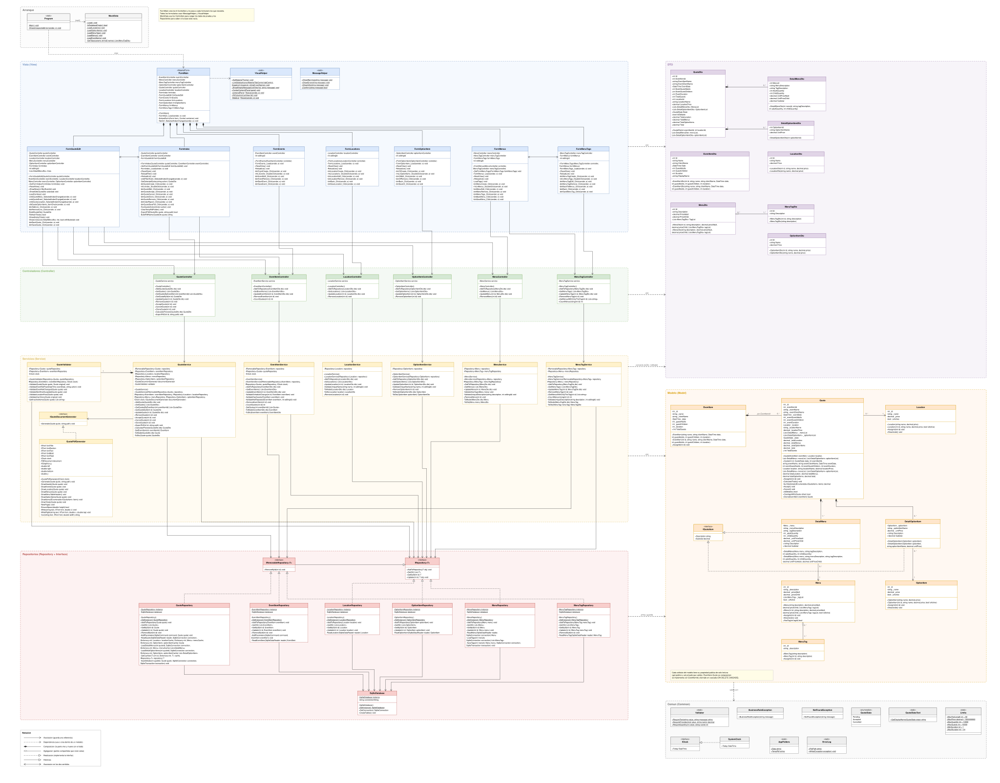
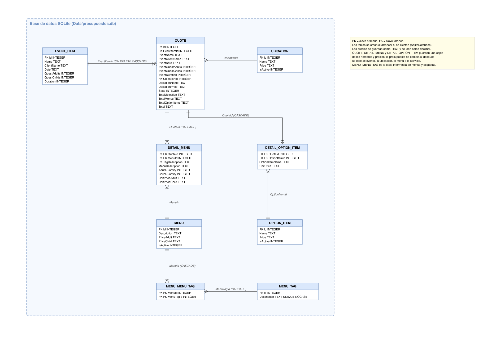

# Sistema Calculador de Presupuestos para Eventos

Aplicación de escritorio en **C# (WinForms, .NET 8)** para armar presupuestos de eventos por cantidad de personas. Calcula el presupuesto al instante a partir del lugar, el catering y los servicios adicionales, lo guarda en una base SQLite para consultarlo después y lo exporta a PDF.

---

## Índice

1. [Funcionalidades](#1-funcionalidades)
2. [Cómo ejecutarlo](#2-cómo-ejecutarlo)
3. [Arquitectura en capas](#3-arquitectura-en-capas)
4. [Modelo de dominio](#4-modelo-de-dominio)
5. [Cálculo del presupuesto](#5-cálculo-del-presupuesto)
6. [Integridad de los objetos](#6-integridad-de-los-objetos)
7. [Reglas de negocio](#7-reglas-de-negocio)
8. [Ciclo de vida del presupuesto](#8-ciclo-de-vida-del-presupuesto)
9. [Datos congelados y clonación](#9-datos-congelados-y-clonación)
10. [Persistencia](#10-persistencia)
11. [Conceptos de POO aplicados](#11-conceptos-de-poo-aplicados)
12. [Diagramas](#12-diagramas)
13. [Tecnologías](#13-tecnologías)

---

## 1. Funcionalidades

- **Catálogo**
  - **Ubicaciones:** salones con su precio por hora.
  - **Menús de catering:** precio por adulto y por niño, con **etiquetas** que representan variantes o particularidades (estándar, vegano, sin TACC, diabético...).
  - **Etiquetas:** se crean en su propia pantalla y se asignan a los menús.
  - **Servicios adicionales:** descripción y monto fijo, independiente del lugar, el menú y los invitados.
- **Eventos:** nombre, cliente, fecha y hora, duración en horas, invitados adultos y niños.
- **Presupuestos**
  - Se arman eligiendo evento, ubicación, líneas de catering (menú + etiqueta + cantidades) y servicios.
  - El **total se calcula en vivo** mientras se arma.
  - Estados **Pendiente**, **Aceptado** y **Cancelado**; se pueden editar (solo Pendiente), aceptar, cancelar, clonar y eliminar.
  - Lista con filtro por evento.
- **Vista previa y PDF** del presupuesto, con el detalle línea por línea y los totales.
- **Persistencia en SQLite:** los datos quedan guardados al cerrar el programa.

## 2. Cómo ejecutarlo

**Requisitos:** Windows, [.NET 8 SDK](https://dotnet.microsoft.com/download/dotnet/8.0) y Visual Studio 2022 (o la línea de comandos de `dotnet`).

1. Abrir `ProyectoPresupuestoEvento.sln` en Visual Studio.
2. Ejecutar con **F5**. Los paquetes NuGet (`MaterialSkin.2` y `Microsoft.Data.Sqlite`) se restauran solos.
3. La primera vez se crea la base `Data/presupuestos.db` en la carpeta del proyecto y se cargan datos de ejemplo (`Mock/MockData`). La base no forma parte del repositorio.

Desde la línea de comandos:

```bash
dotnet run --project ProyectoPresupuestoEvento.csproj
```

El PDF se genera con la impresora **"Microsoft Print to PDF"** de Windows.

## 3. Arquitectura en capas

Cada capa tiene **una sola responsabilidad** y solo conoce a la capa de abajo. Un pedido baja de capa en capa y la respuesta vuelve subiendo:

```
View  ──DTO──▶  Controller  ──DTO──▶  Service  ──Model──▶  Repository (IRepository<T>)  ──SQL──▶  SQLite
```

| Carpeta | Capa | Responsabilidad | Qué no hace |
|---|---|---|---|
| `View/`, `FormMain` | Vista | Captura lo que escribe el usuario, arma un DTO, llama al Controller y muestra el resultado o el error | No calcula ni conoce el modelo ni la base |
| `Controller/` | Controlador | Punto de entrada único desde la vista: delega cada pedido en su Service | No tiene lógica de negocio |
| `Service/` | Servicio | Reglas de negocio, conversión DTO ↔ Model (`toModel`, `toDto`) y validaciones que miran varios objetos o la base | No sabe cómo se guardan los datos |
| `Repository/`, `Interface/` | Persistencia | Guarda y lee objetos del modelo en SQLite con SQL parametrizado | No valida reglas |
| `Model/` | Dominio | Clases del negocio con sus datos, validaciones y cálculos | No conoce DTOs, vista ni base |
| `Dto/` | Transporte | Objetos simples entre la vista y el Service | No tienen lógica |
| `Common/` | Compartido | `Validator`, `BusinessRuleException`, `NotFoundException`, enum `EstadoPresupuesto` | — |
| `Mock/` | Arranque | Datos de ejemplo si la base está vacía | — |

Cada entidad tiene su "columna" con el mismo patrón: formulario → controller → service → repositorio. Por ejemplo, `FormUbications` → `UbicationController` → `UbicationService` → `UbicationRepository`.

**Justificación (POO):** separar responsabilidades da **bajo acoplamiento** y **alta cohesión** (principio de *responsabilidad única*): si cambia la pantalla se toca la vista, si cambia una regla el Service o el Model, y si cambia el almacenamiento solo el Repository. Por eso se pudo pasar de listas en memoria a SQLite sin modificar ni los Services ni la vista.

### Cómo viajan los datos

- **Entre la vista y el Service viajan DTOs.** La vista nunca toca un objeto del modelo: no puede llamar a `accept()` ni modificar un presupuesto, solo enviar datos. Los DTO referencian otras entidades **por id** (`UbicationId`, `MenuId`) y traen datos listos para mostrar.
- **Entre el Service y el Repository viajan objetos del modelo.** `toModel(dto)` arma el objeto con su constructor (y así se valida al nacer); `toDto(model)` lo convierte de vuelta.

Ejemplo, crear una ubicación:

```
FormUbications            new UbicationDto(nombre, precio)
  → UbicationController   delega
  → UbicationService      toModel(dto) → new Ubication(...)   (el set valida nombre y precio)
                          validateUniqueName(...)              (regla que mira otros registros)
                          repository.addToRepository(ubicacion)
  → UbicationRepository   INSERT ... ; SELECT last_insert_rowid();  →  ubicacion.assignId(id)
```

Ejemplo, el total en vivo: la vista arma un `QuoteDto` con lo elegido y llama a `calculatePreview`. El Service arma el presupuesto real, el modelo calcula y el Service devuelve el DTO con los totales **sin guardarlo**. La vista nunca hace una cuenta de precios.

### La pestaña Inicio

Tiene tres formularios en el **mismo panel**: `FormIndex` (la lista), `FormQuoteEdit` (la carga) y `FormReport` (la vista previa). Se crean con `TopLevel = false` y `Dock = Fill` y se alternan mostrando uno y escondiendo los otros, así que nunca aparecen como ventanas aparte.

## 4. Modelo de dominio

| Clase | Representa | Datos y comportamiento |
|---|---|---|
| `EventItem` | Un evento de un cliente | Nombre, cliente, fecha y hora, adultos, niños, duración. Calcula `TotalGuests` |
| `Ubication` | Un salón | Nombre, precio por hora, activo. `deactivate()` |
| `Menu` | Una opción de catering | Descripción, precio por adulto y por niño, etiquetas, activo. `hasTag()`, `deactivate()` |
| `MenuTag` | Una variante o particularidad del menú | Descripción |
| `OptionItem` | Un servicio adicional | Nombre, monto fijo, activo |
| `Quote` | Un presupuesto | Copia de los datos del evento y la ubicación, líneas, estado y totales. `calculateTotals()`, `getItems()`, `accept()`, `cancel()`, `isEditable()`, `overlapsWith()`, `clone()` |
| `DetailMenu` | Una línea de catering | Menú, etiqueta (texto), adultos, niños, copia de descripción y precios. `Subtotal` |
| `DetailOptionItem` | Un servicio dentro del presupuesto | Servicio, copia de nombre y precio. `Subtotal` |
| `IQuoteItem` | Contrato común de los ítems del presupuesto | `Description` y `Subtotal` |

### Relaciones

| Relación | Tipo | Por qué |
|---|---|---|
| `Quote` ◆— `DetailMenu`, `DetailOptionItem` | **Composición** | Las líneas se crean para un presupuesto, no se comparten (al clonar se copian), no tienen id propio y se borran con él |
| `EventItem` ◆— `Quote` | **Composición** (por id) | Un presupuesto no tiene sentido sin su evento. Se implementa con `Quote.EventItemId`: borrar el evento borra sus presupuestos |
| `Menu` ◇— `MenuTag` | **Agregación** | Las etiquetas existen solas, se comparten entre menús (muchos a muchos) y sobreviven al menú |
| `Quote` → `Ubication`, `DetailMenu` → `Menu`, `DetailOptionItem` → `OptionItem` | **Asociación** | Son elementos del catálogo que el presupuesto usa, con su propio ciclo de vida. Los precios no se leen por la referencia: se copian |
| `DetailMenu`, `DetailOptionItem` ⇢ `IQuoteItem` | **Realización** | Implementan el contrato de ítem del presupuesto |
| `QuoteService` ◆— `QuoteValidator` | **Composición** | El service crea su validador y le delega las reglas de los presupuestos |

Para distinguir agregación de composición: *si se borra el todo, ¿las partes siguen teniendo sentido?* Una etiqueta sí (agregación); una línea de catering no (composición).

## 5. Cálculo del presupuesto

Todos los importes son `decimal`. Los calcula el propio modelo, en `Quote.calculateTotals()`, con los datos copiados en el presupuesto:

| Concepto | Fórmula |
|---|---|
| Subtotal de una línea de catering | `precioAdulto × adultos + precioNiño × niños` |
| Subtotal de un servicio | su monto fijo |
| `TotalUbication` | `precioPorHora × duración del evento` |
| `TotalMenus` | suma de los subtotales de catering |
| `TotalOptionItems` | suma de los servicios |
| `Total` | `TotalUbication + suma de los subtotales de todos los ítems` |

El total se suma **polimórficamente** sobre `IQuoteItem`, sin preguntar el tipo de cada ítem:

```csharp
decimal totalItems = 0;
foreach (IQuoteItem item in getItems())
{
    totalItems = totalItems + item.Subtotal;
}
Total = TotalUbication + totalItems;
```

**Ejemplo:** evento de 5 h, 80 adultos y 20 niños, en un salón de $50.000/h. Menú Milanesa ($15.000 por adulto y $8.000 por niño) en tres variantes, y DJ por $200.000.

| Línea de catering | Adultos | Niños | Subtotal |
|---|---|---|---|
| Milanesa · Estándar | 65 | 18 | 15.000 × 65 + 8.000 × 18 = 1.119.000 |
| Milanesa · Vegana | 10 | 0 | 15.000 × 10 = 150.000 |
| Milanesa · Sin TACC | 5 | 2 | 15.000 × 5 + 8.000 × 2 = 91.000 |

- Ubicación: 50.000 × 5 = **250.000**
- Catering: **1.360.000** (las variantes cuestan lo mismo)
- Servicios: **200.000**
- **Total = 1.810.000**

## 6. Integridad de los objetos

La integridad se protege en capas sucesivas, y cada regla vive donde está la información para revisarla. El objetivo es que **un objeto nunca pueda existir en un estado inválido**.

1. **El objeto se protege a sí mismo (Model)**
   - Atributos privados y propiedades con **`get` público y `set` privado que valida**. Nadie de afuera puede escribir `ubicacion.Price = -5`.
   - Los constructores asignan a través de las propiedades, así que la validación corre siempre al crear un objeto.
   - Las validaciones comunes están centralizadas en `Common/Validator`: texto obligatorio de hasta 50 caracteres, precio entre 0 y 1.000.000.000 con 2 decimales como máximo, cantidad entre 0 y 10.000.
   - Los cambios de estado solo ocurren por métodos con guardas: `assignId()` (una sola vez), `deactivate()`, `accept()` y `cancel()` (solo desde Pendiente).
   - Las referencias obligatorias (ubicación, listas de líneas, menú y servicio de cada línea) rechazan `null`.
   - Hay un **constructor de lectura** para reconstruir los objetos desde la base sin modificarlos después.
2. **Reglas que miran varios objetos o la base (Service):** nombres únicos, eventos repetidos, horarios ocupados, elementos dados de baja, etc. (ver la sección 7). Las de los presupuestos están en `QuoteValidator`.
3. **La base de datos:** claves primarias y foráneas, `UNIQUE` en las etiquetas, borrado en cascada y transacciones.

Cuando una regla no se cumple se lanza `BusinessRuleException` (o `NotFoundException` si un registro no existe). La vista atrapa la excepción y muestra el mensaje con `MessageHelper`.

**Editar no modifica: reemplaza.** Como los `set` son privados, editar siempre es armar un objeto **nuevo** desde el DTO (que se valida entero al nacer) y hacer `UPDATE ... WHERE Id = @id` con sus datos.

## 7. Reglas de negocio

### Datos básicos (Model)
- Nombres y descripciones obligatorios, de hasta 50 caracteres. En un evento, el cliente también es obligatorio.
- Precios entre 0 y 1.000.000.000, con 2 decimales como máximo.
- Invitados adultos y niños no negativos, con un máximo de 10.000 en total.
- Duración en horas enteras, de 1 a 24.
- En cada línea de catering, cantidades entre 0 y 10.000.

### Catálogo y eventos (Services)
- No puede haber dos ubicaciones, menús o servicios **activos** con el mismo nombre (sin distinguir mayúsculas). Un nombre dado de baja se puede reutilizar.
- La descripción de una etiqueta es única (también lo garantiza la base con `UNIQUE COLLATE NOCASE`).
- Un menú tiene al menos una etiqueta. La etiqueta no cambia el precio: todas las variantes cuestan lo mismo.
- Un evento tiene al menos un invitado.
- Al **crear** un evento, la fecha no puede ser anterior a hoy. Al editarlo se acepta cualquier fecha.
- No puede haber dos eventos con el mismo nombre, cliente y día.
- Si un evento tiene un presupuesto aceptado, no se puede cambiar su fecha, hora ni duración.

### Presupuestos (`QuoteValidator`)
- Cada línea de catering tiene al menos un plato.
- Un mismo menú con la misma etiqueta no se repite (en la pantalla, si se agrega de nuevo, se suman las cantidades). El mismo menú con otra etiqueta sí: Milanesa estándar y Milanesa vegana son dos líneas.
- La etiqueta de una línea tiene que ser una de las que ese menú tiene asignadas.
- Un servicio no se repite.
- No hay límite de platos según los invitados (puede haber varios bloques de menú o invitados sin catering). Como referencia, la pantalla muestra los invitados del evento.
- Un presupuesto nuevo o clonado solo usa ubicación, menús y servicios **activos**. Al editar un Pendiente se pueden conservar los que ya tenía aunque se hayan dado de baja.
- No se puede crear, clonar ni aceptar un presupuesto de un evento que ya pasó.

### Integridad entre entidades
- **Baja lógica:** eliminar una ubicación, un menú o un servicio no lo borra; lo marca inactivo con `deactivate()`. Desaparece de las listas, pero los presupuestos que lo usan siguen funcionando y lo muestran como "(dado de baja)".
- **Etiquetas:** se borran físicamente, salvo que sean la única etiqueta de algún menú. Los presupuestos no cambian, porque cada línea guarda el texto de la etiqueta.
- **Eventos:** se borran físicamente junto con todos sus presupuestos, con confirmación.
- **Presupuestos:** se pueden eliminar en cualquier estado, con confirmación; sus líneas se borran en cascada.
- Los ids los asigna la base (`AUTOINCREMENT`).

## 8. Ciclo de vida del presupuesto

```
            accept()
Pendiente ───────────▶ Aceptado    (congelado)
    │
    │ cancel()
    ▼
Cancelado   (congelado)
```

- Todo presupuesto nuevo o clonado nace **Pendiente**, y solo un Pendiente se puede editar.
- `State` tiene `set` privado: el estado solo cambia con `accept()` o `cancel()`, que revisan que el presupuesto esté Pendiente (**encapsulamiento** aplicado a un ciclo de vida).
- Al **aceptar** se revisa que:
  - el evento no haya pasado;
  - los datos del evento no hayan cambiado desde que se guardó el presupuesto (si cambiaron, hay que editarlo y guardarlo antes);
  - el evento no tenga otro presupuesto aceptado;
  - el salón no esté ocupado en ese horario por otro aceptado (`Quote.overlapsWith` compara los intervalos de inicio a inicio + duración).
- Aceptado y Cancelado son estados finales. Para retomarlos se clonan.

## 9. Datos congelados y clonación

### Congelamiento

Un presupuesto acordado no puede cambiar si después se modifica el catálogo o el evento. Por eso cada presupuesto guarda **su propia foto** de los datos:

| Clase | Qué copia al construirse |
|---|---|
| `Quote` | Nombre, cliente, fecha, invitados y duración del evento; nombre y precio de la ubicación; totales |
| `DetailMenu` | Descripción del menú, precios por adulto y por niño, texto de la etiqueta |
| `DetailOptionItem` | Nombre y precio del servicio |

Se mantiene congelado porque:
- `calculateTotals()` usa solo las copias y no hace nada si el presupuesto no está Pendiente;
- todos los `set` son privados;
- la base guarda las copias y los totales, y el constructor de lectura los reconstruye tal cual;
- `toDto` arma el DTO solo con las copias, así que la vista previa y el PDF muestran exactamente lo guardado.

Un Pendiente toma los datos y precios actuales solo cuando se edita y se guarda, porque `toModel` arma todo de nuevo.

### Clonación

`Quote.clone(evento)` crea un presupuesto **nuevo y Pendiente** con la misma ubicación, catering y servicios:

- **Las líneas se copian nuevas** (`new DetailMenu(...)`): una parte de una composición pertenece a un solo todo, así que no se comparten entre presupuestos.
- **Las referencias al catálogo se comparten**: la ubicación, los menús y los servicios son asociaciones a objetos que se usan en muchos presupuestos.
- **Toma los datos y precios actuales**, porque las líneas nuevas se construyen con el constructor de creación.
- `QuoteService.cloneQuote` decide si se puede: no debe usar elementos dados de baja, el evento no puede haber pasado, y las líneas se revisan como si se armaran a mano.

## 10. Persistencia

### `IRepository<T>` y Singleton

```csharp
internal interface IRepository<T> where T : class
{
    void addToRepository(T obj);
    List<T> getAll();
    T getById(int id);
    void update(int id, T obj);
    void removeById(int id);
}
```

- Los seis repositorios implementan `IRepository<T>` y son **Singleton**: constructor privado, atributo estático `instance` y método estático `getInstance()`. Hay una sola base y un solo punto de acceso a cada tabla, compartido por todos los services.
- `SqliteDatabase` también es Singleton: arma la conexión a `Data/presupuestos.db` con claves foráneas activadas y crea las tablas si no existen.
- Cada Service **recibe por constructor** los `IRepository<T>` que necesita (*inyección de dependencias*). El constructor sin parámetros, que usa el Controller, le pasa los repositorios reales:

```csharp
public EventItemService()
    : this(EventItemRepository.getInstance(), QuoteRepository.getInstance())
{
}

public EventItemService(IRepository<EventItem> repository, IRepository<Quote> quoteRepository)
{
    this.repository = repository;
    this.quoteRepository = quoteRepository;
}
```

Los services no se crean entre sí: si uno necesita datos de otra entidad, recibe su repositorio.

### Cómo trabaja un repositorio

- `addToRepository`: `INSERT` con parámetros y `SELECT last_insert_rowid()`; después `obj.assignId(id)`.
- `getAll` / `getById`: `SELECT` y un método `readX(reader)` que usa el constructor de lectura. Ubicaciones, menús y servicios filtran `WHERE IsActive = 1` en `getAll`; `getById` trae también los inactivos, que los presupuestos viejos necesitan.
- `update`: `UPDATE ... WHERE Id = @id`.
- **Transacciones:** un presupuesto se guarda en `QUOTE`, `DETAIL_MENU` y `DETAIL_OPTION_ITEM` dentro de una transacción (todo o nada). Lo mismo un menú con sus etiquetas.
- **Parámetros SQL** (`@name`): evitan inyección SQL.

### Esquema

- Una tabla por entidad, más `MENU_MENU_TAG` para la relación muchos a muchos entre menús y etiquetas.
- Una tabla de detalle por tipo de ítem (`DETAIL_MENU`, `DETAIL_OPTION_ITEM`), con clave foránea a `QUOTE` y `ON DELETE CASCADE`: es la composición en la base.
- Importes como `TEXT` (sin pérdida de precisión del `decimal`), estado como número, booleanos 0/1, fechas en formato ISO.

Un tipo de ítem nuevo implica una clase que implemente `IQuoteItem`, su tabla de detalle y su guardado en `QuoteRepository`; el cálculo del total no cambia.

## 11. Conceptos de POO aplicados

| Concepto | Dónde |
|---|---|
| **Abstracción** | Las clases del modelo representan el negocio. `IRepository<T>` abstrae "guardar y leer" sin decir cómo. Los DTO abstraen lo que la pantalla necesita |
| **Encapsulamiento** | `set` privados que validan, estado cambiado solo por métodos con guardas, constructores privados en los Singleton |
| **Polimorfismo** | Por interfaz en el dominio (`IQuoteItem`: cada ítem calcula su subtotal a su manera) y en la persistencia (`IRepository<T>`). También genéricos y sobrecarga de constructores (creación y lectura) |
| **Herencia** | Solo donde hay un "es un" real: `NotFoundException : BusinessRuleException : Exception`, y los formularios heredan de `Form`. En el dominio se usa **composición sobre herencia**: un presupuesto *tiene* líneas, no *es* una |
| **Composición / agregación / asociación** | Ver la sección 4 |
| **Responsabilidad única** | Cada capa y cada clase hace una cosa: `QuoteValidator` las reglas, `QuotePdf` la hoja, `MessageHelper` los mensajes, `VisualHelper` la apariencia |
| **Abierto/cerrado** | El total se calcula sobre `IQuoteItem`: un ítem nuevo se agrega sin modificar el cálculo |
| **Inversión de dependencias** | Los services dependen de `IRepository<T>` y la reciben por constructor |
| **Experto en información** | Cada objeto calcula con sus propios datos: la línea sabe su subtotal y el presupuesto sabe sumar sus ítems |
| **Patrones** | Singleton (repositorios y `SqliteDatabase`), Repository y DTO |
| **Tipado explícito** | No se usa `var`: todas las variables declaran su tipo |

## 12. Diagramas

- [Docs/UML.md](Docs/UML.md): cómo está ordenado el diagrama, la notación y las decisiones que muestra.
- [Docs/UML.drawio](Docs/UML.drawio): el diagrama editable en [draw.io](https://www.drawio.com/), con las páginas "Clases" y "Base de datos".





## 13. Tecnologías

- C# / .NET 8, Windows Forms
- [MaterialSkin.2](https://github.com/leocb/MaterialSkin) 2.3.1 para la interfaz
- [Microsoft.Data.Sqlite](https://learn.microsoft.com/dotnet/standard/data/sqlite/) 8.0 para la base de datos
- `PrintDocument` y "Microsoft Print to PDF" para la vista previa y el PDF
